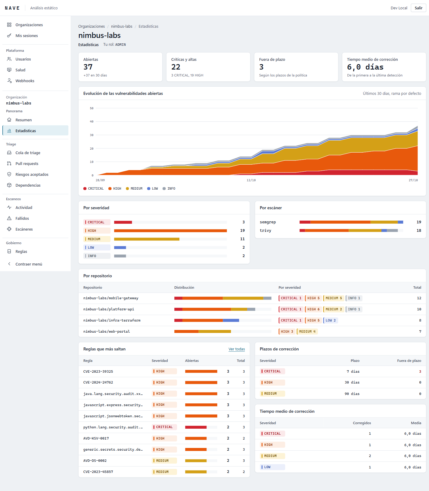
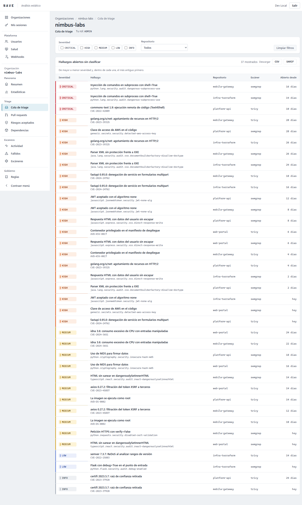
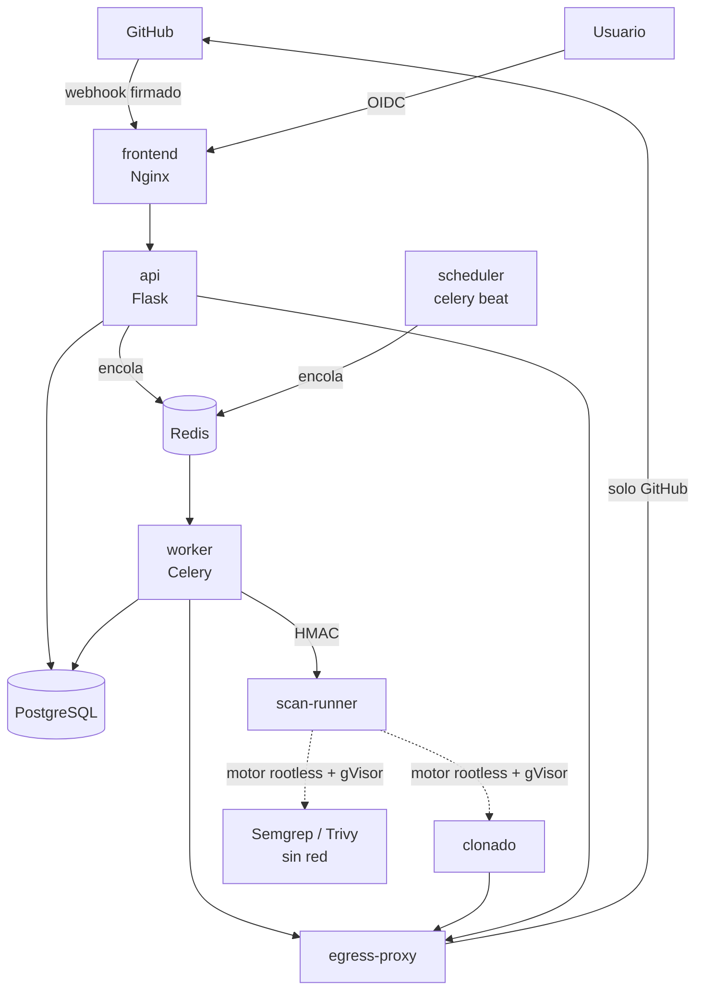

# NAVE

**Nodo de Análisis y Verificación Estática.** Plataforma interna que escanea el código de los
repositorios de GitHub en cada push y pull request con **Semgrep** (SAST) y **Trivy** (dependencias,
secretos e IaC), aplica una política de quality gates y devuelve el resultado a GitHub como check y
comentario en la PR. Incluye una consola web para clasificar (triage) los hallazgos.

El punto de partida de todo el diseño es una sola idea: **NAVE ejecuta herramientas sobre código
que no es de fiar**, así que el propio escáner es superficie de ataque.





*Capturas con datos de demostración.*

## Qué lo hace interesante

- **Cada escaneo, en contenedores efímeros aislados con gVisor.** El clonado y cada escáner corren
  en contenedores de un solo uso: sin red (salvo el clonado, que solo alcanza el proxy), sistema
  de ficheros de solo lectura, sin capacidades, usuario sin privilegios, límites de CPU, memoria,
  PIDs y tiempo, y bajo el kernel de usuario de gVisor sobre Docker rootless. Solo un componente,
  `scan-runner`, habla con el motor de contenedores, mediante un protocolo firmado con HMAC.
- **Salida a Internet con lista blanca.** Un proxy (Smokescreen) solo deja pasar `github.com`,
  `api.github.com` y `codeload.github.com`; es la única ruta hacia fuera de toda la plataforma.
- **El repositorio analizado no puede desactivar el análisis.** Se ignoran su `.semgrepignore`,
  `trivy.yaml`, `.trivyignore` y comentarios `nosemgrep`; un contrato en CI lo comprueba contra
  las imágenes reales.
- **Arquitectura hexagonal verificada por máquina.** `domain` y `application` no importan nada de
  infraestructura; import-linter lo exige en CI. Añadir un escáner es un adaptador nuevo, sin tocar
  el núcleo.
- **Cadena de suministro verificable.** Imágenes fijadas por digest, dependencias con hashes,
  acciones de CI fijadas por SHA y la plataforma se escanea a sí misma en cada cambio. El
  workflow de publicación está preparado para generar SBOM CycloneDX y firmar con cosign (aún no
  se ha ejecutado).
- **Revisión de seguridad documentada.** Una revisión como atacante, componente a componente,
  encontró **35 problemas** (3 de ellos bloqueantes), todos corregidos o aceptados con justificación,
  y cada corrección lleva su test de regresión. Varios solo aparecieron al probar contra GitHub real
  y contra el entorno de producción (Docker rootless + gVisor): ver el
  [informe ejecutivo](docs/security/fase7-informe-ejecutivo.md).

## Arquitectura



Flujo de un escaneo:

1. GitHub envía un webhook. La API verifica la firma HMAC sobre el cuerpo crudo, deduplica por
   `X-GitHub-Delivery`, registra el trabajo en PostgreSQL y responde 202.
2. El worker pide un token de instalación de un solo repositorio y ordena al runner clonar el
   commit en un volumen efímero (el token entra por stdin, nunca en argumentos).
3. El runner lanza Semgrep y Trivy sobre ese volumen, en solo lectura y sin red.
4. El worker normaliza la salida a SARIF 2.1.0, calcula huellas estables, compara con la rama base,
   evalúa la política y publica el check y el comentario en la PR.

PostgreSQL es la única fuente de verdad. Redis solo transporta mensajes, con un usuario por
servicio y permisos mínimos.

## Stack

| Capa | Tecnología |
|---|---|
| Backend | Python 3.12, Flask, Pydantic v2, SQLAlchemy 2 + Alembic, Celery; mypy `--strict` |
| Frontend | Vue 3 + TypeScript estricto, Vite, Feature-Sliced Design; cliente generado desde OpenAPI |
| Datos | PostgreSQL 16 (roles sin privilegios), Redis (solo transporte) |
| Escáneres | Semgrep 1.180, Trivy 0.75, con versiones e imágenes fijadas |
| Aislamiento | Docker rootless + gVisor (`runsc`) en producción |
| Despliegue | Docker Compose endurecido, Nginx con CSP estricta y Trusted Types |
| CI | GitHub Actions: lint, tipos, tests, import-linter, autoescaneo, construcción de imágenes, contratos de aislamiento |

## Calidad

| Suite | Tests |
|---|---|
| Backend (unitarios, seguridad, integración con PostgreSQL real, e2e) | 2.144 (cobertura 97 %) |
| Runner | 279 |
| Fetcher (path guard, clonado endurecido) | 65 |
| Despliegue (Compose, Nginx, workflows, imágenes) | 82 |
| Frontend (incluye contraste WCAG y XSS) | 305 |

## Puesta en marcha

**Desarrollo en Windows (Docker Desktop):**

```powershell
copy deploy\env.dev.example deploy\.env
python deploy/scripts/init_secrets.py
python deploy/scripts/dev_certs.py
powershell -ExecutionPolicy Bypass -File deploy\scripts\dev_up.ps1
powershell -ExecutionPolicy Bypass -File deploy\scripts\dev_demo.ps1   # datos de demostración
```

Abre `https://localhost` (usuario `dev`, clave `dev`; Keycloak solo existe en el perfil de desarrollo).
Con Docker Desktop el sandbox **no** es una barrera de seguridad real.

**Producción (Linux con Docker rootless y gVisor):** sigue el
[runbook de producción](docs/runbooks/produccion-rootless-gvisor.md) y la guía de
[despliegue](docs/architecture/despliegue.md).

## Documentación

| Documento | Contenido |
|---|---|
| [`CLAUDE.md`](CLAUDE.md) | Fuente de verdad del proyecto: reglas, arquitectura y decisiones |
| [`docs/presentacion.md`](docs/presentacion.md) | NAVE en cinco minutos: cifras, historias y guion de demo |
| [`docs/security/fase7-informe-ejecutivo.md`](docs/security/fase7-informe-ejecutivo.md) | Resumen de la revisión de seguridad |
| [`docs/security/fase7-revision.md`](docs/security/fase7-revision.md) | Revisión detallada: vectores, pruebas y evidencias |
| [`docs/threat-model.md`](docs/threat-model.md) | Modelo de amenazas STRIDE y riesgos residuales |
| [`docs/adr/`](docs/adr/README.md) | 33 decisiones de arquitectura (ADR) |
| [`docs/architecture/`](docs/architecture/) | Puertos y contratos, modelo de datos, despliegue |
| [`docs/runbooks/`](docs/runbooks/) | Procedimientos operativos |

## Estructura

| Ruta | Contenido |
|---|---|
| `backend/src/nave/` | `domain`, `application`, `infrastructure`, `delivery`, `bootstrap` |
| `backend/tests/` | `unit`, `integration`, `contract`, `security`, `e2e` |
| `frontend/src/` | `app`, `pages`, `widgets`, `features`, `entities`, `shared` |
| `runner/` | `scan-runner`, solo biblioteca estándar |
| `deploy/` | Nginx, Redis, PostgreSQL, proxy de salida, imágenes del sandbox y scripts |
| `contracts/` | OpenAPI y vectores del protocolo worker ↔ runner |
| `.github/` | CI, publicación, Dependabot |

## Estado

Fases 0 a 7 completadas, incluida la revisión de seguridad final, con un escaneo real contra
GitHub y un despliegue de producción simulado (Docker rootless + gVisor). Antes de un despliegue
real queda repetir el runbook en el servidor definitivo y probar el workflow de publicación.

## Uso

Herramienta de **uso interno**. Las reglas del registro de Semgrep tienen una licencia que no
permite ofrecerlas como servicio a terceros; ofrecer NAVE a terceros exigiría revisar antes las
licencias de reglas y escáneres (modelo de amenazas, AM-905).
