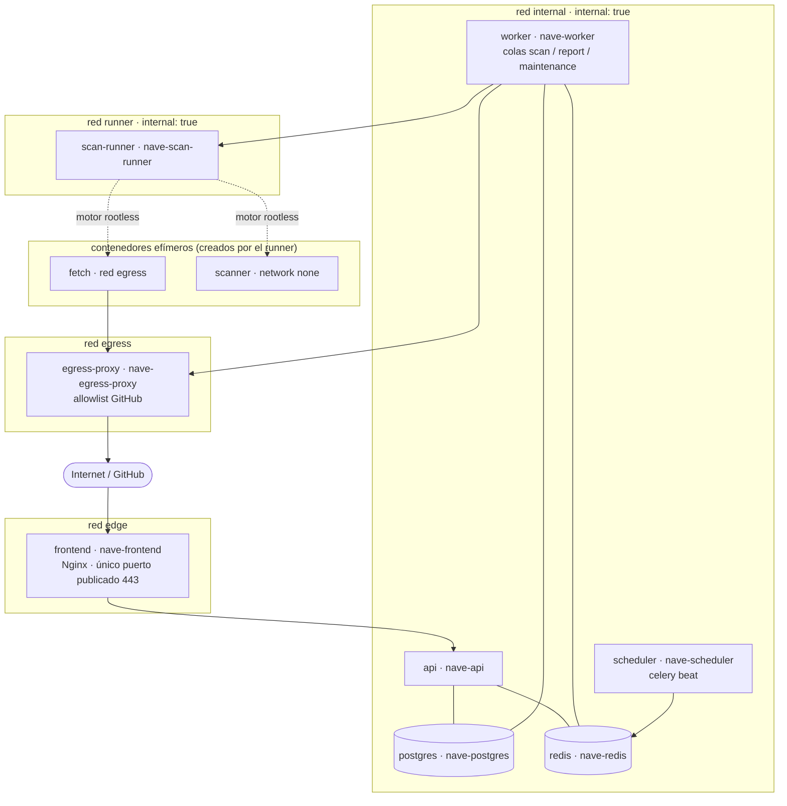

# Despliegue

| Campo | Valor |
|---|---|
| Fase | 0 — diseño; implementado en la fase 6 (ADR 0022) |
| Fecha | 2026-10-11 |
| Implementación | Fase 6 |
| Depende de | ADR 0002 (`scan-runner`), ADR 0007 (`egress-proxy`), ADR 0008 (`scheduler`) — aceptados |

## 1. Topología



## 2. Servicios

| Servicio | Redes | Puerto al host | Secretos (Docker secrets) | Notas |
|---|---|---|---|---|
| `frontend` | edge | 443 (y 80 → redirección) | Certificado TLS | Estáticos de Vue + reverse proxy `/api/` |
| `api` | edge, internal | — | `db_app_password`, `redis_password`, `webhook_secret`, `session_secret`, `oidc_client_secret` | **Sin** la clave de la GitHub App |
| `worker` | internal, runner, egress | — | `db_app_password`, `db_maintenance_password`, `redis_password`, `github_app_private_key`, `runner_hmac_key`, `fingerprint_key` (HMAC de huellas de secretos, AM-805; `openssl rand -hex 32`) | Único que habla con GitHub y con el runner. Se lanza con pool `prefork` (los límites de tiempo no se aplican con `solo`) y `--max-tasks-per-child`. `db_maintenance_password` solo la usan las tareas de retención (ADR 0011) |
| `postgres` | internal | — | `db_superuser_password` (solo init), `db_app_password`, `db_migrator_password` | Volumen `pgdata` |
| `redis` | internal | — | `redis_password` | ACL; sin persistencia de negocio |
| `scan-runner` | runner | — | `runner_hmac_key` | Socket del motor rootless (prod); ADR 0002 |
| `egress-proxy` | egress | — | — | ADR 0007 |
| `scheduler` | internal | — | `redis_password` | `celery beat`; solo encola tareas en `maintenance` (ADR 0008) |

Comunes a todos (§15): `read_only: true` con `tmpfs` donde haga falta, `cap_drop: [ALL]`, `security_opt: [no-new-privileges:true]`, usuario no root, `healthcheck`, límites de CPU y memoria, `restart: unless-stopped`, imagen fijada por digest.

## 3. Volúmenes

| Volumen | Uso | Montado en |
|---|---|---|
| `pgdata` | Datos de PostgreSQL | `postgres` |
| `trivy-db` | BD de Trivy desde un mirror controlado | Solo lectura en el contenedor scanner; lectura y escritura solo en el job de actualización |
| `ws-<run_id>` | Workspace efímero, tmpfs con `size=` | fetch (escritura) → scanner (solo lectura). Lo crea y destruye el runner |

Las reglas de Semgrep van **dentro de la imagen del escáner**, versionadas y fijadas por digest. No son un volumen editable.

## 4. Entornos

| Aspecto | Desarrollo (Windows + Docker Desktop) | Producción (host Linux) |
|---|---|---|
| Motor para el runner | Socket de Docker Desktop | Docker rootless o Podman de un usuario sin privilegios |
| Runtime del sandbox | runc | gVisor (`runsc`) |
| OIDC | Keycloak en el perfil `dev` | Proveedor corporativo |
| TLS | Certificado local autofirmado | Certificado real + HSTS |
| ¿Límite de seguridad? | **No** (S-07) | Sí |

## 4b. Runner: configuración (ADR 0012)

| Elemento | Detalle |
|---|---|
| Worker | `NAVE_RUNNER_URL`, `NAVE_RUNNER_HMAC_KEY_FILE` (secreto `runner_hmac_key`), `NAVE_SEMGREP_VERSION`, `NAVE_TRIVY_VERSION` (versión esperada; si no coincide, la salida se rechaza) |
| Runner | Secreto `runner_hmac_key`; imágenes de fetch, Semgrep y Trivy por digest en su configuración; `DOCKER_HOST` apunta al socket del motor rootless; `--pull never` |
| Volumen `nave-trivy-db` | Solo lectura para el contenedor Trivy; se rellena fuera de banda hasta la fase 6 |
| Imágenes | `deploy/scanner-sandbox/{fetcher,semgrep,trivy}`; el runner tiene `runner/Dockerfile` |

## 5. Decisiones cerradas

- Actualización de la BD de Trivy: script de operador en el host (§6), sin ampliar la allowlist del proxy.

## 6. Implementación (fase 6)

Artefactos: `docker-compose.yml` (+ `docker-compose.dev.yml`), `backend/Dockerfile`, `deploy/nginx/`, `deploy/postgres/init-roles.sh`, `deploy/redis/entrypoint.sh`, `deploy/egress-proxy/acl.yaml`, `deploy/keycloak/nave-realm.json`, `deploy/scripts/`, `.github/workflows/`.

Cambios respecto al diseño original:

- Redes `edge`, `internal`, `runner` y `egress` son `internal: true`. `egress-proxy` está además en `public` y es la única ruta a Internet. `api` entra en `egress` solo para el discovery OIDC por el proxy (ADR 0020).
- `frontend` publica 80 → 8080 (redirección) y 443 → 8443 (Nginx sin privilegios).
- Servicios puntuales del perfil `ops`: `migrate` (Alembic con `nave_migrator`) y `cli` (primer administrador).
- Perfil `dev`: Keycloak con reino importado y certificado propio.

### Primer arranque

```
python deploy/scripts/pin_images.py > deploy/images.lock.env   # una vez, con acceso a los registros; se versiona
cp deploy/images.env.example deploy/images.env                  # bases del lock + digests firmados por `release`
cp deploy/env.example deploy/.env                               # valores no secretos
python deploy/scripts/init_secrets.py --gid 65532               # genera los secretos; faltan los manuales
docker compose --env-file deploy/images.env --env-file deploy/.env up -d postgres redis
docker compose --env-file deploy/images.env --env-file deploy/.env --profile ops run --rm migrate
docker compose --env-file deploy/images.env --env-file deploy/.env up -d
```

Secretos manuales: `github_app_private_key`, `oidc_client_secret`, `tls_cert`, `tls_key`. El IdP de producción debe añadirse a `deploy/egress-proxy/acl.yaml` (sin esto el discovery OIDC es rechazado por el proxy).

### Base de datos de Trivy

El escáner la monta en solo lectura desde el volumen `nave-trivy-db`. Se rellena y actualiza desde el host, fuera de Compose y fuera del proxy de salida:

```
NAVE_TRIVY_IMAGE=ghcr.io/<propietario>/nave-trivy@sha256:<digest> python deploy/scripts/update_trivy_db.py
```

Prográmalo cada 12 h (cron o temporizador de systemd) y la primera vez antes de lanzar escaneos. Pendiente de verificar con Docker: que `chown` exista en la imagen y que el volumen quede en `/db/db/trivy.db`.

### Verificar la firma antes de desplegar

```
cosign verify \
  --certificate-identity-regexp '^https://github.com/<PROPIETARIO>/<REPO>/\.github/workflows/release\.yml@refs/tags/v' \
  --certificate-oidc-issuer https://token.actions.githubusercontent.com \
  ghcr.io/<propietario>/nave-backend@sha256:<digest>
```

### Verificación pendiente (requiere Docker)

El entorno de desarrollo de esta fase no tenía Docker ni acceso a los registros, así que **no se ha ejecutado** `docker compose up`. Los tests de `deploy/tests` validan el YAML, Nginx por texto y los workflows, pero no sustituyen a esta lista:

1. `docker compose config` sin errores con `images.env` real.
2. `nginx -t` dentro de la imagen; comprobar cabeceras con `curl -skI https://localhost/` y que `/api/` las conserva. (La CSP exacta ya se verificó en Chromium sobre el build de producción: sin violaciones.)
3. ~~Smokescreen: flags, esquema del ACL y healthcheck~~ Resuelto en dev (2026-10-18): `--config-file` con `allow_missing_role`, ACL `default:` y sonda `/healthcheck`; ver §7.
4. Permisos de los secretos (`uid`/`gid` de los ficheros montados) con el usuario 65532 en Linux.
5. Que Redis acepte la ACL (`-@admin`) con Celery/Kombu y que el worker arranque con `inspect ping` como healthcheck.
6. Keycloak dev: `keycloak.localhost` resuelve en el navegador de Windows; la API confía en `tls_cert` vía `SSL_CERT_FILE`.
7. ~~En un navegador real: la CSP no bloquea nada (consola sin violaciones) y el flujo de login completo.~~ Resuelto en dev (2026-10-25): en Chrome, las 8 rutas con cargas completas y la CSP real (con `require-trusted-types-for 'script'`) sin ningún mensaje de consola; el login completo se verificó en la fase 7 (componente 5).
8. `deploy/scanner-sandbox/semgrep/requirements.lock` está generado para Semgrep 1.180.0 (`uv pip compile --universal`, con hashes); regenerarlo al cambiar `NAVE_SEMGREP_VERSION`.
9. **IP de cliente real (F7-13).** Nginx fija `X-Forwarded-For` con `$remote_addr` y la API confía en un salto (`NAVE_TRUSTED_PROXY_HOPS=1`); el límite de inicio de login es por IP. Si el motor o un balanceador delante de Nginx sustituyen la IP de origen (Docker Desktop, motor rootless con ciertos controladores de puertos, un L7 sin `real_ip`), **todos los usuarios comparten un único cubo** y el login se bloquea con 429 en cuanto varios entran a la vez. Tras desplegar, comprobar con dos clientes distintos que el registro de acceso de la API muestra sus IP y no la de la pasarela; si no, usar un controlador de puertos que conserve el origen (por ejemplo `slirp4netns` en Docker rootless) o configurar `set_real_ip_from` con el PROXY protocol o el balanceador.

## 7. Desarrollo local en Windows (Docker Desktop)

Primer despliegue real (2026-10-12), con estos ajustes respecto a lo escrito en seco:

- `deploy/scripts/dev_up.ps1` construye las imágenes (`docker-compose.build.yml`, etiquetas `nave-*:dev` de `deploy/images.dev.env`), calcula el digest de las imágenes de escáner (el runner exige digest), migra y levanta el perfil `dev`. `dev_logs.ps1` vuelca estado y logs a `deploy/dev-logs.txt` (ignorado por git).
- `deploy/scripts/dev_demo.ps1` carga (o retira con `-Remove`) datos de demostración (`deploy/dev/demo_data.sql`, marca `github_installation_id = 999000001`).
- Correcciones que salieron del arranque real: `--access-logformat` (nombre real de la opción de gunicorn) y `--no-control-socket`; `celery --app` apunta a módulos (`nave.bootstrap.celery_worker` / `celery_beat`); la imagen del runner copia el paquete a `site-packages` (`python -I` ignora `PYTHONPATH`); Smokescreen no tiene imagen oficial pública, se compila desde el módulo Go (`deploy/egress-proxy/Dockerfile`) y `allow_missing_role` va en `--config-file` (no en el ACL ni como flag; corregido el 2026-10-18, ver abajo).
- Verificado con tráfico real (2026-10-18, `CONNECT` desde el worker): el proxy deja pasar `github.com`, `api.github.com` y `codeload.github.com` y rechaza con 407 `example.com`, `raw.githubusercontent.com`, `gist.github.com`, `169.254.169.254`, `localhost` y `10.0.0.1`. Esto destapó que `allow_missing_role` no pertenece al ACL: ahora vive en `deploy/egress-proxy/config.yaml` (`--config-file`, que apunta al ACL con `acl_file`). La imagen `scratch` no trae `nc`, así que el healthcheck usa la sonda `/healthcheck` (`deploy/egress-proxy/healthcheck.go`, solo stdlib) y el override de dev del proxy y del worker desapareció (RR-19).
- Resultado de la lista de §6 en dev: (2) `nginx -t` correcto y cabeceras reales confirmadas; (3) Smokescreen: config y sonda corregidas y probadas; (5) el worker arranca sano con la ACL de Redis (`inspect ping`); (6) `keycloak.localhost` resuelve y el login completo funciona; los secretos se leen con el usuario no root (servicios sanos). Siguen sin verificar: (1) `docker compose config` con `images.env` de producción (digests), (4) permisos de secretos en Linux nativo, (7) consola del navegador sin violaciones de CSP en esta ejecución (solo comprobado en la fase 6), (8) regenerar el lock de Semgrep al cambiar de versión. Tampoco se ha probado un escaneo real (requiere GitHub App) ni el login OIDC a través del proxy.

## 8. Mantenimiento de la cadena de suministro (fase 7, C9)

- **Digests de imágenes base:** `python deploy/scripts/pin_images.py` resuelve las etiquetas de `BASE` y escribe `deploy/images.lock.env`; se ejecuta al actualizar y se revisa en el PR. CI exige que el lock sea válido y cubra las plantillas.
- **Componentes compilados desde fuente:** `deploy/build-versions.env` fija la versión de Smokescreen (`v0.1.0`). `deploy/egress-proxy/Dockerfile` compila en un módulo propio y eleva `logrus`, `x/net` y `x/text` por CVE; al cambiar la versión de Smokescreen hay que repetir `trivy image` y retirar las elevaciones que ya no hagan falta.
- **Imágenes propias publicadas:** backend, frontend, runner, fetcher, semgrep, trivy y egress-proxy (matriz de `release.yml`, con SBOM CycloneDX y firma cosign); un test impide que falte alguna.
- **Dependabot** (`.github/dependabot.yml`): github-actions, npm, pip y docker, semanal. Las acciones se mantienen fijadas por SHA.
- **Autoescaneo:** la única excepción de secretos es el token ficticio del vector firmado (`.github/trivy-secret.yaml`).
