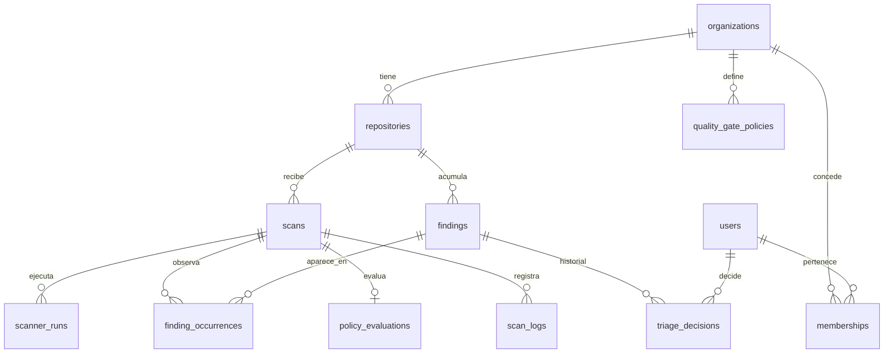

# Modelo de datos

| Campo | Valor |
|---|---|
| Fase | 0 — diseño |
| Fecha | 2026-10-11 |
| Implementación | Fase 3: `infrastructure/persistence/schema.py` y migración `alembic/versions/0001_initial_schema.py`. Un test (`alembic check` / `compare_metadata`) garantiza que no divergen |

PostgreSQL es la única fuente de verdad (§7). Claves primarias UUIDv4 salvo donde se indique. Todas las marcas temporales son `timestamptz` en UTC.

## 1. Diagrama entidad-relación

## 2. Tablas

### `organizations`
| Columna | Tipo | Restricciones |
|---|---|---|
| id | uuid | PK |
| github_installation_id | bigint | UNIQUE, NOT NULL |
| github_account_login | text | NOT NULL |
| status | enum(`ACTIVE`,`SUSPENDED`,`UNINSTALLED`) | NOT NULL |
| uninstalled_at | timestamptz | NULL (inicia la gracia de 30 días, ADR 0006) |
| created_at | timestamptz | NOT NULL |

### `repositories`
| Columna | Tipo | Restricciones |
|---|---|---|
| id | uuid | PK |
| organization_id | uuid | FK → organizations, NOT NULL |
| github_repo_id | bigint | UNIQUE, NOT NULL (sobrevive a renombrados) |
| owner, name | text | NOT NULL, validados como `RepoRef` |
| default_branch | text | NOT NULL |
| enabled | boolean | NOT NULL (allowlist, §9) |
| created_at | timestamptz | NOT NULL |

### `users`
| Columna | Tipo | Restricciones |
|---|---|---|
| id | uuid | PK |
| oidc_issuer, oidc_subject | text | UNIQUE (issuer, subject) |
| email, display_name | text | NULL; solo informativos, **nunca** sirven para autorizar |
| created_at, last_login_at | timestamptz | |

### `memberships`
| Columna | Tipo | Restricciones |
|---|---|---|
| user_id | uuid | PK compuesta, FK |
| organization_id | uuid | PK compuesta, FK |
| role | enum(`VIEWER`,`TRIAGER`,`ADMIN`) | NOT NULL |
| granted_by | uuid | FK → users, NULL solo para el admin creado por CLI |
| granted_at | timestamptz | NOT NULL |

### `scans`
| Columna | Tipo | Restricciones |
|---|---|---|
| id | uuid | PK |
| repository_id | uuid | FK, NOT NULL |
| commit_sha | char(40) | CHECK `~ '^[0-9a-f]{40}$'` |
| ref | text | NOT NULL |
| pull_request_number | integer | NULL |
| trigger | enum(`WEBHOOK`,`MANUAL`) | NOT NULL |
| trigger_key | varchar(128) | UNIQUE (idempotencia: delivery ID o ID de petición manual) |
| status | enum ScanStatus | NOT NULL |
| status_reason_code | enum ReasonCode | Obligatorio si `FAILED`, `TIMED_OUT` o `CANCELLED` (CHECK); el código válido depende del estado |
| status_reason_detail | varchar(256) | Texto saneado; vacío por defecto |
| requested_by | uuid | FK → users, NULL si es webhook |
| superseded_by | uuid | FK → scans, NULL |
| queued_at, started_at, finished_at | timestamptz | |
| requeued_at | timestamptz | NULL. Marca del barrido de mantenimiento: se reencola una sola vez (AM-308) |
| summary | jsonb | Recuentos por severidad; esquema validado en la aplicación |
| version | integer | Bloqueo optimista |

Índices: `(repository_id, ref, queued_at DESC)`; `(status)` parcial para los estados no terminales.

### `scanner_runs`
| Columna | Tipo | Restricciones |
|---|---|---|
| id | uuid | PK |
| scan_id | uuid | FK; UNIQUE (scan_id, scanner_kind) |
| scanner_kind | varchar(32) | NOT NULL; CHECK `~ '^[a-z][a-z0-9-]{0,30}[a-z0-9]$'` |
| scanner_version | text | NOT NULL |
| image_digest | text | CHECK `~ '^sha256:[0-9a-f]{64}$'` |
| status | enum(`SUCCEEDED`,`FAILED`,`TIMED_OUT`) | |
| output_sha256 | char(64) | Procedencia (AM-603) |
| findings_count | integer | |
| truncated | boolean | NOT NULL |
| started_at, finished_at | timestamptz | |

### `findings`
Identidad estable de un hallazgo dentro de un repositorio.

| Columna | Tipo | Restricciones |
|---|---|---|
| id | uuid | PK |
| repository_id | uuid | FK; UNIQUE (repository_id, fingerprint) |
| fingerprint | char(64) | NOT NULL |
| scanner_kind, rule_id | text | NOT NULL |
| severity | enum Severity | NOT NULL |
| cwe, cve | text[] | |
| title | text | ≤ 500 caracteres |
| triage_state | enum TriageState | NOT NULL; copia del último `triage_decisions` |
| triage_expires_at | timestamptz | Obligatorio exactamente cuando `triage_state = ACCEPTED_RISK` (CHECK); el estado efectivo vuelve a `OPEN` al caducar |
| first_seen_scan_id, last_seen_scan_id | uuid | FK → scans |
| first_seen_at | timestamptz | Base para los SLAs |

Índices: `(repository_id, triage_state, severity)` para el listado y los quality gates.

### `finding_occurrences`
Dónde apareció un finding en un escaneo concreto.

| Columna | Tipo | Restricciones |
|---|---|---|
| scan_id | uuid | PK compuesta, FK |
| finding_id | uuid | PK compuesta, FK |
| path | text | Ruta relativa validada (AM-602), ≤ 1024 |
| start_line, end_line | integer | ≥ 1 |
| message | text | ≤ 4096; texto plano |
| snippet | text | ≤ 2048; saneado (AM-703) y redactado si es un secreto (AM-801) |

### `triage_decisions` (append-only)
| Columna | Tipo | Restricciones |
|---|---|---|
| id | uuid | PK |
| finding_id | uuid | FK |
| state | enum TriageState | NOT NULL |
| justification | text | Obligatorio si `ACCEPTED_RISK` o `FALSE_POSITIVE` (CHECK) |
| expires_at | timestamptz | Obligatorio si `ACCEPTED_RISK` (CHECK) |
| decided_by | uuid | FK → users |
| decided_at | timestamptz | NOT NULL |

`nave_app` solo tiene `INSERT` y `SELECT` sobre esta tabla.

### `quality_gate_policies`
| Columna | Tipo | Restricciones |
|---|---|---|
| id | uuid | PK |
| organization_id | uuid | FK; UNIQUE (organization_id, version) |
| version | integer | |
| document | jsonb | Validado con el esquema de ADR 0003 |
| active | boolean | Índice único parcial: una sola activa por organización |
| created_by, created_at | | |

### `policy_evaluations`
| Columna | Tipo | Restricciones |
|---|---|---|
| scan_id | uuid | PK, FK |
| policy_id | uuid | FK (versión exacta evaluada) |
| verdict | enum(`PASS`,`FAIL`,`NEUTRAL`) | |
| reasons | jsonb | |
| evaluated_at | timestamptz | |

### `scan_logs`
| Columna | Tipo | Restricciones |
|---|---|---|
| scan_id | uuid | PK compuesta |
| seq | bigint | PK compuesta; cursor para el polling (ADR 0005) |
| ts | timestamptz | |
| level | enum | |
| message | text | ≤ 4096; sin caracteres de control (AM-704) |

### `webhook_deliveries`
| Columna | Tipo | Restricciones |
|---|---|---|
| delivery_id | uuid | PK (`X-GitHub-Delivery`) |
| event | text | |
| received_at | timestamptz | |
| outcome | enum(`ENQUEUED`,`IGNORED`,`REJECTED`) | |

### `audit_log` (append-only, con evidencia de manipulación)
| Columna | Tipo | Restricciones |
|---|---|---|
| id | bigint | PK (identity) |
| occurred_at | timestamptz | |
| actor_user_id | uuid | NULL para acciones del sistema |
| organization_id | uuid | |
| action | text | p. ej. `finding.triaged`, `policy.activated`, `access.denied` |
| target_type, target_id | text | |
| request_id | text | |
| details | jsonb | Sin secretos |
| prev_hash, hash | char(64) | `hash = sha256(prev_hash ‖ fila canónica)`: encadenado verificable |

### `outbox_events`
| Columna | Tipo | Restricciones |
|---|---|---|
| id | bigint | PK, identidad; fija el orden de publicación |
| type | varchar(64) | Nombre de la clase del evento |
| payload | jsonb | Solo IDs y valores de dominio, sin secretos |
| occurred_at | timestamptz | |
| published_at | timestamptz | NULL hasta que el relay lo publica; se purga a los 7 días |

## 3. Roles de base de datos

| Rol | Permisos |
|---|---|
| `nave_migrator` | DDL. Solo lo usa el job de migraciones de Alembic |
| `nave_app` | DML sobre las tablas de negocio; solo `INSERT`/`SELECT` en `audit_log` y `triage_decisions` |
| `nave_maintenance` | `DELETE` sobre las tablas con retención (ADR 0006); sin acceso a `audit_log` |

Ninguno es superusuario (§0).
