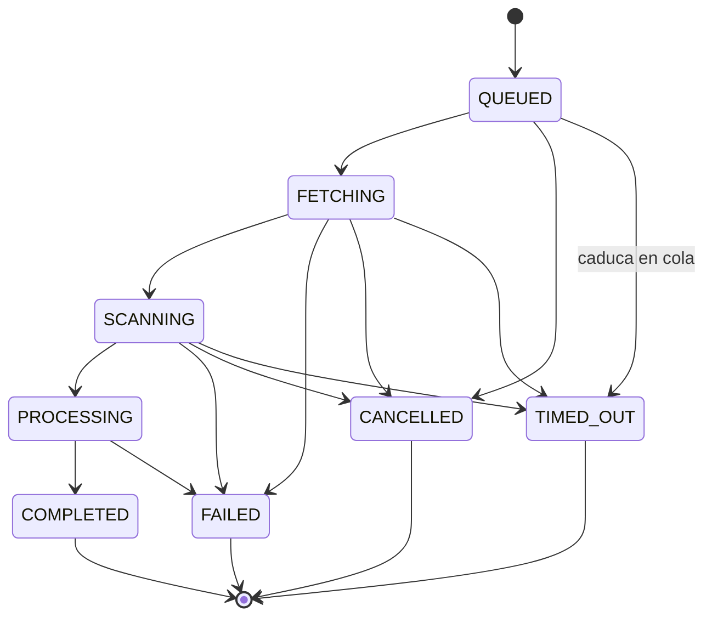

# Puertos y contratos

| Campo | Valor |
|---|---|
| Fase | 0 — diseño |
| Fecha | 2026-10-11 |
| Implementación | Fase 1 (`backend/src/nave/application/ports/`) |

Las firmas son el contrato que se implementará en fase 1. Aquí aparecen como documentación, no como código del repositorio. Todos los puertos son `typing.Protocol`, viven en `application/ports/` y solo referencian tipos de `domain` o DTOs de `application/dto`.

---

## 1. Tipos de dominio referenciados

| Tipo | Clase | Invariante |
|---|---|---|
| `ScanId`, `FindingId`, `OrganizationId`, `RepositoryId`, `UserId` | Value object (UUID) | UUIDv4, generado por `IdGenerator` |
| `CommitSha` | Value object | `^[0-9a-f]{40}$` |
| `RepoRef` | Value object | `owner`: `^[A-Za-z0-9](?:[A-Za-z0-9-]{0,38})$`; `name`: `^[A-Za-z0-9._-]{1,100}$`, distinto de `.` y `..` |
| `GitRef` | Value object | Reglas de `git check-ref-format` + sin `-` inicial, sin caracteres de control ni de formato Unicode, sin espacios Unicode; ≤ 255 bytes UTF-8 |
| `ScannerKind` | Value object (texto validado) | `^[a-z][a-z0-9-]{0,30}[a-z0-9]$` (`semgrep`, `trivy`). No es un enum: añadir un escáner no toca el dominio; el catálogo es el `ScannerRegistry` de infraestructura |
| `Severity` | Enum ordenado | `CRITICAL > HIGH > MEDIUM > LOW > INFO` |
| `ScanStatus` | Enum + máquina de estados | Ver §4 |
| `TriageState` | Enum | `OPEN`, `FALSE_POSITIVE`, `ACCEPTED_RISK`, `FIXED` |
| `Fingerprint` | Value object | 64 caracteres hex (SHA-256). Ver §5 |
| `Role` | Enum ordenado | `ADMIN > TRIAGER > VIEWER` |
| `TriggerKey` | Value object | `^[A-Za-z0-9][A-Za-z0-9:._-]{0,127}$`; clave de idempotencia (`gh-delivery:<id>`, `manual:<id>`) |
| `StatusReason` | Value object | `ReasonCode` (enum) + `detail` ≤ 256 caracteres sin caracteres de control ni de formato. `from_untrusted()` sanea texto no confiable |
| `WorkspaceHandle` | Value object opaco | Identificador del workspace en el runner. **La aplicación nunca ve rutas** (ADR 0002) |

## 2. Puertos obligatorios (CLAUDE.md §5.2)

### `ScannerPort`

```python
class ScannerPort(Protocol):
    @property
    def kind(self) -> ScannerKind: ...

    def scan(self, workspace: WorkspaceHandle, limits: ScanLimits) -> ScannerOutput:
        """Ejecuta el escáner sobre el workspace dentro del sandbox.

        Devuelve el SARIF ya parseado con esquema estricto y acotado.
        No interpreta severidades ni calcula fingerprints: eso es responsabilidad
        del normalizador de application/services.
        """
```

- `ScannerOutput`: `kind`, `scanner_version`, `image_digest`, `sarif: SarifLog` (DTO inmutable, subconjunto de SARIF 2.1.0), `output_sha256`, `truncated: bool`, `duration`.
- Errores: `ScannerTimeoutError`, `ScannerOutputInvalidError`, `ScannerExecutionError` (permanentes) y `ScannerUnavailableError` (transitorio, reintentable).
- **Test de contrato común** (`tests/contract/`): toda implementación debe respetar los límites, ignorar la configuración del repo (AM-503), rechazar salidas mayores que el límite y devolver un resultado determinista para un fixture dado.

### `RepositoryFetcherPort`

```python
class RepositoryFetcherPort(Protocol):
    def checkout(
        self, repo: RepoRef, commit: CommitSha, limits: FetchLimits
    ) -> AbstractContextManager[WorkspaceHandle]:
        """Obtiene el commit exacto en un workspace aislado.

        Garantiza la limpieza del workspace al salir del contexto, también ante
        excepciones. Aplica todo el endurecimiento de git de AM-504.
        """
```

- Errores: `RepositoryTooLargeError`, `RepositoryNotFoundError`, `CommitNotFoundError` (permanentes) y `FetchUnavailableError` (transitorio).

### `ScanRepository`

```python
class ScanRepository(Protocol):
    def get(self, scan_id: ScanId) -> Scan: ...                       # ScanNotFoundError
    def add(self, scan: Scan) -> None: ...
    def save(self, scan: Scan) -> None: ...                           # ConcurrentModificationError (bloqueo optimista por version)
    def find_by_trigger_key(self, key: TriggerKey) -> Scan | None: ...
    def find_pending_for_ref(self, repo: RepositoryId, ref: GitRef) -> Sequence[Scan]: ...
```

### `FindingRepository`

```python
class FindingRepository(Protocol):
    def upsert_many(self, repo: RepositoryId, findings: Sequence[Finding]) -> None: ...
    def record_occurrences(self, scan: ScanId, occurrences: Sequence[FindingOccurrence]) -> None: ...
    def get(self, finding_id: FindingId) -> Finding: ...              # FindingNotFoundError
    def list(self, query: FindingQuery, page: PageRequest) -> Page[FindingView]: ...
    def baseline_fingerprints(self, repo: RepositoryId, ref: GitRef) -> frozenset[Fingerprint]: ...
```

- `upsert_many` es idempotente por `(repository_id, fingerprint)`.
- `PageRequest.limit` tiene un tope máximo (200).

### `ScanQueuePort`

```python
class ScanQueuePort(Protocol):
    def enqueue(self, step: ScanStep, scan_id: ScanId) -> None: ...
    def revoke(self, scan_id: ScanId) -> None: ...
```

- `ScanStep`: `EXECUTE` (cola `scan`: obtener, escanear y procesar en una sola tarea, ADR 0009) y `REPORT` (cola `report`). Las tareas periódicas van a la cola `maintenance` (ADR 0008).
- Implementación de referencia de todos los puertos: `application/ports/` (fase 1); fakes en memoria en `tests/fakes/memory.py`.
- El ID de la tarea es determinista (`{scan_id}:{step}`): encolar dos veces no duplica trabajo.

### `EventPublisherPort`

```python
class EventPublisherPort(Protocol):
    def publish(self, events: Sequence[DomainEvent]) -> None: ...
```

Se implementa con **transactional outbox**: los eventos se escriben en la misma transacción que el cambio de estado y un relay los publica. Así no se pierden eventos si el proceso cae entre el commit y la publicación.

### Puertos de mantenimiento (ADR 0011)

```python
class OutboxStore(Protocol):
    def relay_batch(self, limit: int, deliver: Callable[[Sequence[OutboxMessage]], None]) -> int: ...

class EventSinkPort(Protocol):
    def deliver(self, messages: Sequence[OutboxMessage]) -> None: ...

class ScanSweepStore(Protocol):
    def queued_before(self, cutoff: datetime, limit: int) -> Sequence[StaleScan]: ...
    def running_before(self, cutoff: datetime, limit: int) -> Sequence[StaleScan]: ...
    def mark_requeued(self, scan_id: ScanId, at: datetime) -> None: ...

class RetentionStore(Protocol):
    def purge_webhook_deliveries(self, before: datetime, limit: int) -> int: ...
    def purge_scan_logs(self, before: datetime, limit: int) -> int: ...
    def purge_published_outbox(self, before: datetime, limit: int) -> int: ...
    def purge_scans(self, before: datetime, limit: int) -> int: ...
```

`relay_batch` entrega y marca en una sola transacción (si `deliver` lanza, no se marca nada: al menos una vez). `RetentionStore` no ofrece forma de borrar `audit_log` ni `triage_decisions`.

### `PolicyEvaluatorPort`

```python
class PolicyEvaluatorPort(Protocol):
    def evaluate(self, org: OrganizationId, input: PolicyInput) -> PolicyVerdict: ...
```

`PolicyInput` contiene los recuentos por severidad de los findings nuevos y abiertos, con el estado efectivo de triage y las edades para los SLAs. Ver ADR 0003.

### `VcsReporterPort`

```python
class VcsReporterPort(Protocol):
    def publish_check(self, target: VcsTarget, scan: Scan) -> None: ...
    def upload_sarif(self, target: VcsTarget, scan: Scan, findings: Sequence[FindingView]) -> None: ...
    def upsert_pr_comment(self, target: VcsTarget, scan: Scan, body: PrCommentBody) -> None: ...
```

- Todas las operaciones son idempotentes. El check run se identifica por `external_id = scan.id`; el comentario, por un marcador oculto **y** por su autor (el bot de la App, AM-808). `upload_sarif` es opcional (`NAVE_SARIF_UPLOAD`, apagado por defecto) y un rechazo de Code Scanning no hace fallar el reporte. Implementación: `infrastructure/vcs/reporter.py` (ADR 0014).
- `PrCommentBody` se construye ya escapado (AM-802). El adaptador no recibe texto crudo del finding.

### `Clock` e `IdGenerator`

```python
class Clock(Protocol):
    def now(self) -> datetime: ...          # siempre con zona horaria UTC

class IdGenerator(Protocol):
    def new_uuid(self) -> UUID: ...
```

## 3. Puertos adicionales

Necesarios para cumplir §7, §11 y §12. Aprobados el 2026-10-11 e incorporados a §5.2 de CLAUDE.md.

| Puerto | Motivo |
|---|---|
| `UnitOfWork` | Atomicidad entre repositorios y outbox. Es un context manager con `commit()` y rollback implícito |
| `MembershipRepository` | Autorización por organización en cada caso de uso (§12, ADR 0004) |
| `AuditLogPort` | Auditoría inmutable de acciones sensibles y denegaciones (§12) |
| `ScanLogRepository` | Logs de escaneo legibles en la UI, con cursor (ADR 0005) |
| `WebhookDeliveryRepository` | Idempotencia por `X-GitHub-Delivery` (§9) |
| `PolicyRepository` | Versiones del documento de política por organización (ADR 0003) |
| `UserRepository` | Usuarios por `(issuer, subject)`; upsert en el login (ADR 0016) |
| `SessionRepository` | Sesiones opacas; solo se guarda el SHA-256 del token (ADR 0016) |
| `LoginFlowRepository` | Flujos de login de un solo uso (`DELETE ... RETURNING`), TTL 10 min (ADR 0016) |
| `OidcProviderPort` | Discovery, intercambio de código con PKCE y validación del ID token (ADR 0016) |
| `SecretSource` | Lectura del secreto del cliente OIDC desde fichero (ADR 0016) |
| `OrphanedUserStore` | Vaciado de nombre y correo de usuarios sin acceso, con el plazo impuesto en SQL (ADR 0019) |
| `InsightsQueries` | Lecturas agregadas por organización para las vistas de estadísticas, actividad, reglas, riesgos, dependencias, política y auditoría; sin autorización propia, siempre filtradas por organización y con tope (ADR 0028). Desde el ADR 0029 también: PR con su último escaneo, cola de triage paginada, escaneos fallidos, escaneos completados (versiones de escáner) y filas para exportar |
| `FindingExportPort` | Convierte filas de hallazgos a CSV (con neutralización de fórmulas) o SARIF 2.1.0; sin E/S (ADR 0029) |

Métodos de lectura añadidos para la API REST (ADR 0017): `ScanRepository.list_for_repository`, `FindingRepository.view_of` / `decisions_of`, `TenantAdmin.list_repositories` / `find_organizations_by_login`, `MembershipRepository.list_for_user` / `list_members`. Recuentos de abiertos para los listados: `FindingRepository.open_counts_by_organization` / `open_counts_by_repository`.

## 4. Máquina de estados de `ScanStatus`



- Cualquier otra transición lanza `InvalidScanTransitionError` (dominio).
- `PROCESSING` no se puede cancelar: es corto, transaccional y solo toca la BD.
- `FAILED`, `TIMED_OUT` y `CANCELLED` exigen un `StatusReason` con un código propio de ese estado (`policies.REASONS_BY_STATUS`); el resto de estados no lleva motivo.
- `CANCELLED` con código `SUPERSEDED` exige `superseded_by`, y viceversa.
- Implementado en `nave.domain.policies` y `nave.domain.entities.scan` (fase 1).

## 5. Fingerprint estable

```
fingerprint = sha256("v1" | scanner_kind | rule_id | normalized_path | locator)
```

| Tipo de finding | `locator` |
|---|---|
| SAST (Semgrep) | SHA-256 del fragmento coincidente con los espacios normalizados + índice de ocurrencia si se repite en el mismo fichero |
| Vulnerabilidad de dependencia (Trivy) | `ecosistema:paquete` (sin versión: actualizar a otra versión que sigue siendo vulnerable no crea un finding nuevo) |
| Secreto (Trivy) | SHA-256 del valor del secreto (el valor nunca se guarda, AM-801) |
| IaC (Trivy) | Identificador del recurso afectado |

- **No incluye números de línea**: mover código no genera findings nuevos.
- El prefijo `v1` permite cambiar el algoritmo en el futuro con una migración controlada.
- Se exporta como `partialFingerprints` en el SARIF que se sube a GitHub.

## 6. Normalización de severidad

| Origen | Valor nativo | Severidad NAVE |
|---|---|---|
| Semgrep | `ERROR` | `HIGH` (o `CRITICAL` si el metadato de la regla lo indica) |
| Semgrep | `WARNING` | `MEDIUM` |
| Semgrep | `INFO` | `LOW` |
| Trivy | `CRITICAL` / `HIGH` / `MEDIUM` / `LOW` | Igual |
| Trivy | `UNKNOWN` | `INFO` |

La tabla vive en cada adaptador, no en `domain`. Así, añadir un escáner no toca el dominio.

## 7. Casos de uso (fase 1)

| Caso de uso | Disparador | Rol mínimo | Puertos |
|---|---|---|---|
| `StartScan` | API manual | `TRIAGER` | ScanRepository, ScanQueuePort, MembershipRepository, UnitOfWork, AuditLogPort |
| `HandleGithubEvent` | Webhook | — (HMAC) | WebhookDeliveryRepository, ScanRepository, ScanQueuePort, UnitOfWork |
| `FetchAndScan` | Tarea `fetch` | — (interno) | ScanRepository, RepositoryFetcherPort, ScannerRegistry, ScanLogRepository |
| `ProcessScanResults` | Tarea `scan` | — (interno) | FindingRepository, ScanRepository, PolicyEvaluatorPort, UnitOfWork |
| `ReportToVcs` | Tarea `report` | — (interno) | VcsReporterPort, ScanRepository |
| `CancelScan` | API | `TRIAGER` | ScanRepository, ScanQueuePort, AuditLogPort |
| `TriageFinding` | API | `TRIAGER` | FindingRepository, MembershipRepository, AuditLogPort, UnitOfWork |
| `ListFindings` | API | `VIEWER` | FindingRepository, MembershipRepository |
| `GetScanStatus` | API | `VIEWER` | ScanRepository, MembershipRepository |
| `ManageMembership` | API | `ADMIN` | MembershipRepository, AuditLogPort |
| `BeginLogin` | API (login) | — (público) | OidcProviderPort, LoginFlowRepository, UnitOfWork |
| `CompleteLogin` | API (callback) | — (público) | OidcProviderPort, LoginFlowRepository, UserRepository, SessionRepository, AuditLogPort, UnitOfWork |
| `Authenticate` | API (cada petición) | — (sesión) | SessionRepository, UserRepository, UnitOfWork |
| `Logout` | API | — (sesión) | SessionRepository, AuditLogPort, UnitOfWork |
| `ScrubOrphanedUsers` | Tarea diaria | — (interno) | OrphanedUserStore |
| `BootstrapAccess` | CLI | — (operador) | TenantAdmin, UserRepository, MembershipRepository, AuditLogPort |
| `ListMyOrganizations` | API | cualquier miembro | MembershipRepository, TenantAdmin |
| `ListRepositories` | API | `VIEWER` | TenantAdmin, MembershipRepository |
| `ListMembers` | API | `ADMIN` | MembershipRepository, UserRepository |
| `ListScans` | API | `VIEWER` | ScanRepository, MembershipRepository |
| `GetScanVerdict` | API | `VIEWER` | ScanRepository, MembershipRepository |
| `GetFinding` | API | `VIEWER` | FindingRepository, MembershipRepository |

Cada caso de uso es una clase con un único método público `execute(command) -> result`, recibe sus dependencias por constructor y lanza errores propios (CLAUDE.md §18).


## Protocolo worker ↔ `scan-runner` (v1)

Definido en el [ADR 0012](../adr/0012-protocolo-del-runner.md). Endpoint único `POST /v1/runs`, JSON canónico (≤ 4096 bytes), firma HMAC-SHA256 con marca temporal (±60 s) y nonce de un solo uso. Pasos `fetch`, `scan` y `release`. Los vectores de prueba compartidos están en `contracts/runner-protocol-vectors.json`; `RunnerClient` (backend) y `nave_runner.protocol` (runner) los verifican por separado.
