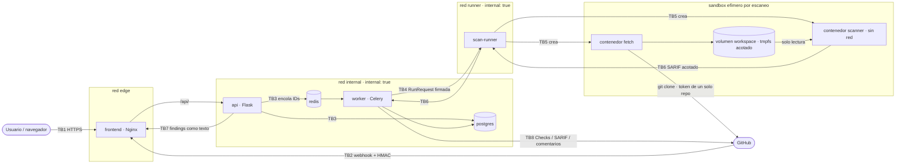

# Modelo de amenazas — NAVE

| Campo | Valor |
|---|---|
| Versión | 0.2 (fase 0 cerrada) |
| Fecha | 2026-10-11 |
| Metodología | STRIDE por límite de confianza sobre el diagrama de flujo de datos |
| Depende de | ADR 0002 (aislamiento por escaneo), ADR 0007 (egress), ADR 0008 (planificador) — aceptados |

Principio rector (CLAUDE.md §1): NAVE ejecuta herramientas sobre código **no confiable**. El propio escáner es superficie de ataque.

---

## 1. Alcance

Incluido: todos los servicios de Compose, el runner de sandbox propuesto (ADR 0002), los contenedores efímeros de fetch y escaneo, la integración con GitHub, la UI y la cadena de suministro de la propia plataforma.

Excluido: seguridad física y del hipervisor, el proveedor OIDC en sí (se asume conforme a la especificación), la infraestructura de GitHub.

## 2. Diagrama de flujo de datos

`api` está conectado a `edge` e `internal`; `worker` a `internal` y `runner`. El egress de `worker` y del contenedor de fetch hacia GitHub pasa por `egress-proxy` (ADR 0007). `scheduler` (ADR 0008) solo publica IDs en Redis y no cruza límites nuevos; por eso no aparece en el diagrama.

## 3. Activos

| ID | Activo | C | I | D | Dónde vive |
|---|---|---|---|---|---|
| A-01 | Clave privada de la GitHub App | Crítica | Crítica | — | Secreto montado **solo** en `worker` |
| A-02 | Secreto de webhook | Alta | Alta | — | Secreto montado **solo** en `api` |
| A-03 | Tokens de instalación (vida ≤ 1 h) | Alta | — | — | Memoria de `worker`; fichero tmpfs del contenedor de fetch |
| A-04 | Código fuente escaneado | Alta | Media | — | Volumen workspace efímero |
| A-05 | Findings, snippets y triage | Alta | Alta | Media | PostgreSQL |
| A-06 | Audit log | Media | Crítica | Media | PostgreSQL (append-only) |
| A-07 | Credenciales de PostgreSQL / Redis / sesión / OIDC | Alta | Alta | — | Docker secrets |
| A-08 | Reglas Semgrep y BD de Trivy | Baja | Crítica | Media | Imagen del escáner / mirror controlado |
| A-09 | Disponibilidad del servicio de escaneo | — | — | Alta | worker, runner, colas |

Un finding es en sí mismo información sensible: describe una vulnerabilidad explotable en un repositorio concreto.

## 4. Actores de amenaza

| ID | Actor | Capacidad |
|---|---|---|
| AT-1 | Atacante externo anónimo | Tráfico arbitrario contra el puerto público de Nginx |
| AT-2 | **Contribuidor malicioso** de un repo escaneado (incluye PRs desde forks) | Controla contenido, nombres de fichero, symlinks, tamaño, manifiestos de dependencias, ficheros de configuración y el texto que aparecerá en los findings. **Es el actor principal.** |
| AT-3 | Usuario autenticado con rol bajo o de otra organización | Sesión válida; intenta IDOR, escalada de rol o acceso cross-tenant |
| AT-4 | Compromiso de la cadena de suministro | Imagen base, binario de escáner, regla, BD de Trivy o dependencia Python/npm manipulados |
| AT-5 | Administrador interno | Se confía en él; sus acciones se auditan, pero no se defienden técnicamente |

## 5. Límites de confianza

| ID | Límite | Lado no confiable |
|---|---|---|
| TB1 | Internet → `frontend` / `api` | Peticiones HTTP |
| TB2 | GitHub → endpoint de webhook | Cuerpo del evento hasta verificar HMAC |
| TB3 | `api` / `worker` → `postgres` / `redis` | Mensajes de cola (se tratan como solo IDs) |
| TB4 | `worker` → `scan-runner` | Petición de ejecución |
| TB5 | `scan-runner` → contenedores sandbox | **Todo** lo que ocurre dentro del sandbox |
| TB6 | Salida del sandbox → parser del `worker` | SARIF / JSON del escáner |
| TB7 | Datos persistidos → navegador | Texto de findings, rutas, nombres de regla, logs |
| TB8 | NAVE → API de GitHub | Contenido que publicamos en PRs |
| TB9 | Cadena de suministro → build y runtime | Imágenes, binarios, reglas, BD, dependencias |

## 6. Análisis STRIDE

Riesgo residual: **A** alto, **M** medio, **B** bajo, tras aplicar la mitigación.

### TB1 — Internet → frontend / api

| ID | STRIDE | Amenaza | Mitigación | Verificación | Res. |
|---|---|---|---|---|---|
| AM-101 | S | Robo o fijación de sesión | OIDC Authorization Code + PKCE; cookie `__Host-` `HttpOnly; Secure; SameSite=Lax` con 256 bits aleatorios y solo su SHA-256 en base de datos; sesión nueva en cada login (un identificador previo nunca se adopta); `state` de un solo uso atado a la cookie del navegador que inició el flujo; expiración absoluta (12 h) e inactividad (30 min); logout revoca en servidor (ADR 0016) | `tests/security/test_session.py`, `tests/unit/application/test_login.py`, `tests/integration/persistence/test_auth_repositories.py` | B |
| AM-102 | T | CSRF en acciones de triage o política | Token CSRF por sesión (`X-CSRF-Token`, `compare_digest`) + `Origin` idéntico al origen público en métodos no seguros (sin `Origin` se rechaza) + SameSite=Lax; sin CORS; todas las rutas declaran su modo de autenticación (denegar por defecto) | `tests/security/test_csrf.py`, `tests/security/test_route_auth_declared.py`. Verificado en vivo con login OIDC real (fase 7, 2026-10-18): `Origin` exacto + token, sin CORS, cierre de sesión revocado en el servidor | B |
| AM-103 | R | Acción sensible sin trazabilidad | Audit log append-only con actor, `request_id`, objetivo y resultado (incluye denegaciones) | `tests/integration/test_audit_log.py` | B |
| AM-104 | I | Fuga de trazas, rutas o versiones | RFC 7807 sin trazas; `server_tokens off`; error handler único; `/readyz` solo `ok`/`unavailable` | `tests/security/test_error_disclosure.py` | B |
| AM-105 | D | Inundación de peticiones o bodies enormes | `limit_req` en Nginx; rate limit por usuario en la app; `client_max_body_size`; paginación con tope máximo; timeouts | Test de carga en fase 6 | M |
| AM-106 | E | IDOR / acceso a otra organización | Autorización por organización y repositorio **dentro de cada caso de uso**, no solo en el borde; IDs UUIDv4 (defensa adicional, nunca la única) | `tests/security/test_tenant_isolation.py`. Verificado en vivo (fase 7, 2026-10-25): matriz de 13 operaciones × 6 usuarios × 3 destinos, 234 celdas, 0 discrepancias; 404 ajeno e inexistente indistinguibles | B |
| AM-107 | E | Escalada de rol | Cambio de rol solo por `admin` de esa organización; auditado; el primer admin se crea por CLI, no por API; la organización nunca se queda sin admin ni con retiradas concurrentes (`lock_admins`, F7-14) | `tests/unit/application/test_membership.py`, `tests/integration/persistence/test_membership_concurrency.py` | B |

### TB2 — GitHub → webhook

| ID | STRIDE | Amenaza | Mitigación | Verificación | Res. |
|---|---|---|---|---|---|
| AM-201 | S | Evento falsificado | Verificar `X-Hub-Signature-256` (HMAC-SHA256) sobre el **cuerpo crudo**, antes de parsear, con `hmac.compare_digest`; rechazar si falta la cabecera | `tests/unit/infrastructure/test_webhook_verifier.py`, `tests/unit/delivery/test_webhook.py::TestAuthentication` | B |
| AM-202 | T | Replay de una entrega válida | Idempotencia por `X-GitHub-Delivery` (restricción única en `webhook_deliveries`). GitHub no firma marca temporal: un replay posterior a la retención solo puede re-disparar un escaneo idempotente por `(repo, commit, trigger)` | `tests/unit/delivery/test_webhook.py::TestIdempotencyAndOutcomes`. Verificado en vivo (fase 7, 2026-10-18) a través de Nginx; excepción en eventos de instalación (RR-27) | B |
| AM-203 | D | Ráfaga de pushes o payloads enormes | Límite de body 5 MiB en Nginx y Flask; responder 202 tras encolar; un push nuevo a la misma ref **sustituye** el escaneo pendiente de un commit anterior (no funcionaba con la base de datos real: F7-15, corregido en la fase 7); límite de escaneos concurrentes por organización | `tests/unit/delivery/test_webhook.py::TestEnvelope` (tamaño, firma antes de parsear), `tests/unit/application/test_use_cases.py` (sustitución de escaneos) | M |
| AM-204 | E | Evento de una instalación o repo no autorizado | Comprobar la allowlist de organizaciones y repos antes de encolar; si no está, 202 sin acción y log | `tests/unit/delivery/test_webhook.py` (instalación ajena, repositorio desconocido) | B |
| AM-205 | E | PR desde fork dispara ejecución sobre código del atacante | **Aceptado por diseño** (es el propósito del producto); contenido por TB5. Política configurable: exigir aprobación para contribuidores nuevos; rate limit por autor | `tests/unit/delivery/test_webhook.py::TestPullRequests::test_fork_prs_follow_the_policy`, `tests/unit/bootstrap/test_api_config.py` (`off` por defecto) | M |
| AM-206 | T | SSRF o clonado de host arbitrario usando `clone_url` del payload | **Nunca** usar URLs del payload. La URL se construye como `https://github.com/{owner}/{name}.git` con `owner` y `name` validados por regex | `tests/security/test_repo_ref_validation.py` | B |

### TB3 — api / worker → postgres / redis

| ID | STRIDE | Amenaza | Mitigación | Verificación | Res. |
|---|---|---|---|---|---|
| AM-301 | S | Suplantación de servicios internos | Red `internal` con `internal: true`; ningún puerto publicado; Redis con ACL y contraseña; PostgreSQL con `scram-sha-256` | Revisión de Compose en CI | B |
| AM-302 | T | Inyección SQL | Solo SQLAlchemy con parámetros; prohibido `text()` con interpolación; regla Semgrep propia en CI | Regla `nave-no-raw-sql` | B |
| AM-303 | T | Manipulación de mensajes en Redis | Los mensajes llevan **solo IDs**; el worker relee el estado desde PostgreSQL y vuelve a validar la transición; Redis nunca es fuente de verdad | `tests/unit/application/test_step_revalidation.py` | B |
| AM-304 | E | RCE por deserialización | `accept_content=["json"]`, `task_serializer="json"`, `result_serializer="json"` | `tests/security/test_celery_config.py`; `tests/integration/queue/test_celery_redis.py::test_a_pickled_message_written_straight_into_redis_is_never_deserialized` (mutación verificada: falla si se acepta pickle). Verificado en vivo en la fase 7 (2026-10-25) sobre el worker real: pickle sobre una tarea registrada → «Refusing to deserialize untrusted content» | B |
| AM-305 | E | Privilegios excesivos en BD | `nave_app` solo DML; `nave_migrator` con DDL, usado únicamente por el job de migración; `nave_app` sin `UPDATE/DELETE` sobre `audit_log` ni `triage_decisions` | `tests/integration/persistence/test_security.py` (roles, triggers append-only). Verificado en vivo en la fase 7 con las credenciales reales: 27 operaciones prohibidas de `nave_app` y 10 de `nave_maintenance` bloqueadas; funciones `SECURITY DEFINER` con plazo interno | B |
| AM-306 | I | Fuga de credenciales | Docker secrets como ficheros, no variables de entorno; redacción en logs | `tests/security/test_log_redaction.py` | B |
| AM-307 | D | Inundación de colas | Longitud máxima por cola (`max_queue_depth`, el encolado falla y el barrido reencola); colas `scan`, `report` y `maintenance` separadas (ADR 0009); un escaneo nuevo sustituye al anterior del mismo ref. La equidad por organización no está implementada: se acepta como RR-08 | `tests/integration/queue/test_celery_redis.py::test_a_full_queue_refuses_work_until_it_drains` | M |
| AM-309 | D | `FindingRepository.list_not_seen_in` carga en memoria todos los hallazgos del repositorio no vistos en el escaneo; en un repositorio con un historial muy grande, un escaneo de la rama por defecto podría consumir mucha memoria del worker | **Cerrado:** `list_not_seen_in` pagina con cursor por ID (500 por página); la memoria queda acotada | `tests/unit/application/test_use_cases.py::TestExecuteScan::test_fixing_pages_through_every_missing_finding`; `tests/integration/persistence/test_repositories.py` | B |
| AM-308 | D | Un escaneo queda en `QUEUED` para siempre si el proceso cae entre el commit y el encolado | El barrido de `maintenance` (cada 5 min) reencola una sola vez los escaneos en `QUEUED` más de 10 min (`scans.requeued_at`) y los expira con `QUEUE_EXPIRED` a los 60. También abandona los escaneos en curso que superan `2 × límite duro` (acota el bucle de un mensaje venenoso). **Implementado (ADR 0011)** | `tests/unit/application/test_maintenance.py`; `tests/integration/persistence/test_maintenance_stores.py::TestPeriodicJobsEndToEnd` | B |

### TB4 — worker → scan-runner (ADR 0002)

| ID | STRIDE | Amenaza | Mitigación | Verificación | Res. |
|---|---|---|---|---|---|
| AM-401 | S | Otro componente ordena ejecuciones | Red `runner` dedicada (solo `worker` y `scan-runner`); petición firmada HMAC-SHA256 con marca temporal ±60 s y nonce de un solo uso | `runner/tests/test_protocol.py`, `runner/tests/test_server.py`, `backend/tests/unit/infrastructure/test_runner_client.py`, `backend/tests/e2e/test_runner_roundtrip.py` (incluye rechazo de marcas anteriores al arranque del runner, ADR 0012) | B |
| AM-402 | T | La petición elige imagen, flags, montajes o red | El runner acepta solo `{run_id, step, scanner_kind (enum), owner, name, commit_sha (^[0-9a-f]{40}$)}`. La especificación del contenedor sale de **plantillas fijas** del runner; las imágenes se fijan por digest en su configuración | `runner/tests/test_schema.py`, `runner/tests/test_sandbox_spec.py` | B |
| AM-403 | E | Compromiso del runner = control del motor de contenedores | Motor **rootless** de un usuario de host sin privilegios (prod) + gVisor; el runner no tiene credenciales de BD ni la clave de la GitHub App; código mínimo y sin dependencias superfluas | `runner/tests/test_service.py::TestSingleFlight` y revisión como atacante de fase 2 (ADR 0012) | **M** |
| AM-404 | D | Saturación del runner | Semáforo de ejecuciones concurrentes; rechazo explícito (429) que el worker reintenta con backoff | `runner/tests/test_service.py`, `runner/tests/test_server.py` (429 y tope de conexiones) | B |

### TB5 — scan-runner → sandbox (código no confiable)

| ID | STRIDE | Amenaza | Mitigación | Verificación | Res. |
|---|---|---|---|---|---|
| AM-501 | E | Escape de contenedor por fallo de kernel o runtime | gVisor (`runsc`) en prod; motor rootless; `cap_drop ALL`; `no-new-privileges`; seccomp; usuario 65532; rootfs de solo lectura; ningún montaje del host salvo el workspace | `runner/tests/test_sandbox_spec.py` | M |
| AM-502 | E | RCE en el propio escáner por entrada manipulada (manifiesto, fichero enorme, parser vulnerable) | Se asume que **el escáner es comprometible**: contenedor de escaneo sin red y sin secretos. Si se compromete, el atacante obtiene el código de ese repo (que ya controlaba) y puede falsear la salida → TB6 | `runner/tests/test_sandbox_spec.py` (`--network none`) | M |
| AM-503 | T | El repo secuestra la configuración del escáner (`.semgrepignore`, `trivy.yaml`, `.trivyignore`, reglas propias) | Reglas y configuración montadas por la plataforma en solo lectura; directorio de trabajo del proceso **fuera** del árbol del repo; flags explícitos que desactivan la configuración local. Los flags exactos se verifican contra la versión fijada en fase 2 | `tests/contract/test_scanner_ignores_repo_config.py` | B |
| AM-504 | T | Ataques vía git: hooks, submódulos, symlinks, CVEs del cliente | `core.hooksPath=/dev/null`; sin submódulos; `core.symlinks=false` (los symlinks se materializan como ficheros de texto); `protocol.allow=never` + `protocol.https.allow=always`; `transfer.fsckObjects=true`; `core.protectNTFS=true`, `core.protectHFS=true`; `--depth 1`; git fijado a versión parcheada | `deploy/scanner-sandbox/fetcher/tests/test_git_clone_hardening.py` | B |
| AM-505 | D | Zip bomb, repo gigante, millones de ficheros, bucles infinitos, fork bomb | Comprobación previa del tamaño vía API de GitHub; workspace en volumen tmpfs con `size=` (1 GiB por defecto); máximo de ficheros; `--pids-limit 256`; `--memory 2g`; `--cpus 2`; timeout de reloj aplicado por el runner (kill); salida estándar truncada a tamaño máximo | `runner/tests/test_sandbox_spec.py`, `deploy/scanner-sandbox/fetcher/tests/test_pathguard.py`. Verificado en vivo (2026-10-18, fase 7): plazo → 504, tope de salida → 413, sin contenedores residuales; el workspace llega al escaneo gracias al sostenedor (ADR 0025, F7-05) | M |
| AM-506 | I | Robo de secretos desde el sandbox | Contenedor de escaneo: ningún secreto. Contenedor de fetch: token de instalación limitado a **un repo** y a `contents:read`, por **stdin** (no en env, argumentos ni fichero; ADR 0012), **revocado en cuanto termina el clonado** y con el alcance **verificado** al emitirlo (ADR 0014); tratado como valor opaco (ADR 0013) | `runner/tests/test_service.py`, `runner/tests/test_engine.py`, `backend/tests/unit/infrastructure/test_github_installation_tokens.py`, `backend/tests/unit/infrastructure/test_runner_fetcher.py` | B |
| AM-507 | I | Exfiltración desde el contenedor de fetch (tiene red) | Egress limitado a GitHub (ADR 0007); el contenedor de fetch no ejecuta nada del repo | Test de red en fase 6. Verificado en vivo en la fase 7 (2026-10-18): sin ruta ni DNS directos, allowlist y SSRF comprobados desde `api`, `worker`, runner y un contenedor de fetch; residual RR-25 | M |

### TB6 — salida del sandbox → worker

| ID | STRIDE | Amenaza | Mitigación | Verificación | Res. |
|---|---|---|---|---|---|
| AM-601 | T | SARIF/JSON malicioso (bomba JSON, anidamiento profundo, cadenas enormes) | Límite de tamaño antes de parsear (50 MiB); límite de profundidad; esquema estricto; máximo de resultados (50 000) y longitud por campo; sin `eval`/`pickle` | `backend/tests/unit/infrastructure/test_sarif_parser.py` | B |
| AM-602 | T | Rutas manipuladas en resultados (`../`, absolutas, esquemas `file://`) | Solo URIs relativas; normalización y rechazo de `..`, bytes nulos y rutas absolutas; la ruta se guarda como dato, nunca se abre | `backend/tests/unit/infrastructure/test_scanner_adapters.py`, `test_sarif_parser.py` | B |
| AM-603 | R | Escáner comprometido oculta findings | Se registran versión, digest de imagen y hash de salida por ejecución. Riesgo residual aceptado (RR-02) | `backend/tests/contract/test_scanner_port_contract.py` | B |

### TB7 — datos → navegador

| ID | STRIDE | Amenaza | Mitigación | Verificación | Res. |
|---|---|---|---|---|---|
| AM-701 | T/E | XSS almacenado vía mensaje, snippet, ruta o nombre de regla | Prohibido `v-html`/`innerHTML` (ESLint `vue/no-v-html` como error + regla Semgrep); solo interpolación de texto; CSP `default-src 'self'; script-src 'self'; object-src 'none'; base-uri 'none'; frame-ancestors 'none'; require-trusted-types-for 'script'` | `frontend/tests/security/xss-corpus.spec.ts`. Verificado en Chrome real en la fase 7 (2026-10-25) con HTML hostil en título, ruta, mensaje, snippet y logs: se muestra como texto, sin elementos ni ejecución, con la CSP incluida `require-trusted-types-for 'script'` (activada en esa revisión: antes la cabecera real no la llevaba, F7-23) | B |
| AM-702 | T | Enlaces maliciosos (`helpUri` del SARIF) | Se muestran como texto; solo se convierten en enlace las URLs `https:` de una allowlist de dominios, con `rel="noopener noreferrer"` | Test unitario del componente | B |
| AM-703 | T | Trojan Source (caracteres bidi Unicode y homóglifos) en snippets | Los caracteres de control bidi y de ancho cero se muestran visibles (p. ej. `<U+202E>`) | `tests/unit/application/test_snippet_sanitizer.py` | B |
| AM-704 | T | Secuencias de escape ANSI en logs de escaneo | Se eliminan los caracteres de control antes de persistir los logs | Mismo test | B |
| AM-705 | I/E | Script ajeno (dependencia comprometida, XSS residual) lee el token CSRF o usa la sesión | Cookie `HttpOnly` que JavaScript no lee; token CSRF solo en memoria de la pestaña, nunca en `localStorage`/`sessionStorage`/URL; CSP sin scripts ni estilos en línea ni `eval`; sin dependencias fuera del ADR 0021 | `frontend/tests/security/` (almacenamiento, CSP de `index.html`, API prohibidas) | M |
| AM-706 | S | Redirección abierta o inyección de parámetros tras el login | El login es una navegación a `/api/v1/auth/login` sin parámetros; el backend redirige siempre a `/`; el frontend no acepta ni reenvía URLs de retorno; las rutas del router son una lista cerrada | `frontend/tests/security/` y `tests/security/test_session.py` | B |

### TB8 — NAVE → API de GitHub

| ID | STRIDE | Amenaza | Mitigación | Verificación | Res. |
|---|---|---|---|---|---|
| AM-801 | I | Publicar un secreto detectado en un comentario de PR, SARIF o UI | Los findings de secretos se **redactan** al normalizar: solo prefijo de 4 caracteres + hash; el valor nunca se persiste | `tests/security/test_secret_redaction.py` | B |
| AM-802 | T | Inyección Markdown en comentarios (menciones masivas, imágenes de rastreo, enlaces engañosos) | Escapar Markdown del texto controlado por el atacante; neutralizar `@` y `#`; no incluir imágenes ni enlaces procedentes del finding | `tests/security/test_pr_comment_escaping.py` | B |
| AM-803 | S | Robo de la clave de la GitHub App | Clave solo en `worker`, como secreto de fichero; `api` no la tiene; tokens de instalación con permisos y repos mínimos; nunca registrados en logs | Revisión de Compose + test de redacción | M |
| AM-805 | I | Fuerza bruta de secretos de baja entropía a partir del fingerprint: el locator de un secreto es su SHA-256 sin sal, y ruta y regla son conocidas | El fingerprint de los hallazgos `SECRET` se calcula con HMAC-SHA256 y una clave del servidor (Docker secret `NAVE_FINGERPRINT_KEY_FILE`, solo en el worker), de modo que una copia de la base de datos no basta para probar candidatos. El valor nunca sale del sandbox ni se guarda (AM-801). Rotar la clave reabre los secretos como nuevos | `tests/security/test_secret_fingerprint_is_keyed.py` | B |
| AM-806 | E | Un token de instalación con más alcance del pedido (GitHub aplica mal el límite, o cambia su formato) llega al sandbox o a la caché | Tras emitirlo se comprueba `repository_selection`, el repositorio único y que los permisos concedidos no superen los pedidos; si no, se revoca y se rechaza. El formato se trata como opaco | `tests/unit/infrastructure/test_github_installation_tokens.py::TestScopeIsVerified` | B |
| AM-807 | S | JWT de la App filtrado o falsificado | El JWT vive ≤ 9 min, solo se firma (la verificación es de GitHub); la clave no se imprime, no se serializa y exige RSA ≥ 2048 bits; la clave solo está en `worker` | `tests/unit/infrastructure/test_github_app_jwt.py`, `tests/security/test_github_credentials.py` | B |
| AM-804 | D | Bloqueo por rate limit | Backoff exponencial con jitter; respetar `Retry-After` y `X-RateLimit-Reset`; cola `report` separada | `tests/unit/infrastructure/test_github_backoff.py` | B |
| AM-808 | S/T | Un tercero escribe en un PR un comentario con el marcador de NAVE para que el reporter lo edite (o lo suplante), o reutiliza el `external_id` de un check run de otra App | El comentario solo se edita si su autor es `Bot` y su login es `<slug>[bot]` de esta App (identidad leída de `GET /app`) y empieza por el marcador; el check run solo se reutiliza si pertenece a esta App (`app.id`). Un 401 invalida el token y se reintenta una vez; un rechazo de Code Scanning no hace fallar el reporte | `tests/unit/infrastructure/test_github_reporter.py` (`TestPrComment`, `TestCheckRun`) | B |
| AM-809 | S/E | Webhook falsificado o manipulado que da de alta una organización o habilita repositorios; o un login de la allowlist reasignado a otra cuenta que hereda una organización; o un repositorio transferido que cambia de inquilino | El webhook solo aporta el id de la instalación: cuenta, estado y repositorios se consultan a GitHub con la credencial de la App; solo se registran cuentas de `NAVE_GITHUB_ALLOWED_ACCOUNTS`; la organización se fija por `github_account_id` inmutable (un id distinto con el mismo login se ignora y se audita); un repositorio ya asignado a otra organización no se mueve (`repository.conflict`); `update_repository` filtra por organización | `tests/unit/application/test_sync_installation.py`, `tests/integration/persistence/test_tenant_admin.py` | B |
| AM-810 | I | Secretos del worker (clave de la App, huella, runner) o del webhook en el proceso equivocado | `ApiSettings` no lee credenciales del worker y la API **no arranca** si encuentra variables del worker; el worker no arranca con las del webhook | `tests/unit/bootstrap/test_api_config.py` | B |
| AM-811 | E/T | Un worker comprometido borra datos de organizaciones activas aprovechando la credencial de mantenimiento (RR-10/RR-11) | `nave_maintenance` no tiene `DELETE` sobre tablas de negocio; solo `EXECUTE` sobre `nave_purge_organization`, que exige en SQL organización `UNINSTALLED` desde hace más de 30 días, fija `search_path`, no está concedida a `PUBLIC` y borra por lotes sin tocar `audit_log`; la purga queda auditada antes y después con `nave_app` | `tests/integration/persistence/test_purge_organization.py`, `tests/unit/application/test_purge_organizations.py` | B |
| AM-812 | S/E | IdP falso o comprometido, o respuesta de descubrimiento manipulada, para suplantar usuarios o desviar el secreto del cliente | Emisor fijado por configuración HTTPS (HTTP solo a bucle local con el interruptor de desarrollo); el documento de descubrimiento debe repetir el emisor exacto y todos sus endpoints deben ser del **mismo origen**; sin redirecciones; ID token validado con `joserfc` (solo algoritmos asimétricos, `iss`, `aud`/`azp`, `exp`, `iat`, `nonce`, `sub`); claves privadas o simétricas en el JWKS se ignoran; refresco de JWKS con intervalo mínimo; salida opcional por proxy `CONNECT` explícito (`NAVE_OIDC_PROXY_URL`, ADR 0020) con TLS de extremo a extremo; correo solo si `email_verified` y nunca autentica; usuario nuevo sin ningún acceso | `tests/unit/infrastructure/test_oidc_client.py`, `tests/unit/infrastructure/test_oidc_transport.py` | B |
| AM-813 | D/E | Abuso del endpoint de login: llenar `login_flows`, o conseguir administración sin ser administrador | Tope de flujos vivos y limpieza acotada; el primer administrador solo existe por CLI con acceso al entorno de operación (auditado, `granted_by` nulo); ninguna ruta HTTP ni variable de entorno concede roles; `nave_app` no puede borrar usuarios y `nave_maintenance` no ve sesiones | `tests/unit/application/test_login.py`, `tests/unit/bootstrap/test_cli.py`, `tests/integration/persistence/test_auth_repositories.py` | B |
| AM-814 | E/S | Suplantar a otro usuario o saltarse la autorización enviando un actor, una organización o un rol en la petición | El actor sale solo de la sesión (`Principal`); los cuerpos son `extra="forbid"` y un campo `actor` es 400; los parámetros de consulta son una lista cerrada; la autorización vive en los casos de uso y un recurso ajeno responde idéntico a uno inexistente (404) mientras que un rol insuficiente de un miembro es 403; `contracts/openapi.json` versionado con test de deriva y de rutas no documentadas | `tests/security/test_tenant_isolation_api.py`, `tests/unit/delivery/test_rest_api.py`, `tests/unit/delivery/test_openapi.py` | B |
| AM-815 | D | Inundar la API o el login con peticiones repetidas (con o sin sesión), o falsificar la IP para eludir o provocar límites | Cubos de fichas: por `user_id` en lecturas y escrituras, por IP solo en login y callback; 429 con `Retry-After`; `X-Forwarded-For` ignorado salvo `NAVE_TRUSTED_PROXY_HOPS` y entonces solo la entrada del proxy declarado; memoria acotada a 10 000 cubos; cookies inválidas no consumen cubo por IP, así que no hay denegación entre vecinos de NAT. Límite por proceso: el control global por IP es del proxy (fase 6) | `tests/security/test_rate_limit.py`, `tests/unit/delivery/test_rate_limit.py`, `tests/unit/bootstrap/test_api_config.py` | M |
| AM-816 | I | Datos personales (nombre, correo) retenidos indefinidamente de personas sin acceso a ninguna organización, o un worker comprometido que abusa de la limpieza | Función `nave_scrub_orphan_users` con plazo mínimo de 30 días impuesto en SQL; solo vacía usuarios sin membresía ni sesión viva; la fila se conserva para no romper la auditoría; `nave_maintenance` solo tiene `EXECUTE` y sigue sin poder actualizar `users` | `tests/integration/persistence/test_scrub_orphan_users.py`, `tests/unit/application/test_scrub_orphaned_users.py` | B |
| AM-817 | T | Finding con título, mensaje, ruta o snippet hostil (HTML, bidi, ANSI) que se ejecuta o engaña al revisor al mostrarse | Sin `v-html`; todo texto del servidor pasa por interpolación escapada y `visibleText` (bidi, ancho cero, control y ANSI visibles); tests con cargas hostiles en tablas, detalle y logs | `tests/security/source.test.ts`, `tests/unit/app/pages.test.ts`, `tests/unit/shared/lib/visible-text.test.ts` | F |
| AM-818 | T | Parámetros de ruta o consulta manipulados (UUID falso, filtros con valores arbitrarios) para alcanzar rutas o enviar valores inesperados a la API | Rutas cerradas con UUID por expresión regular (lo demás es not-found); el filtro de la URL se reduce a listas cerradas y la URL se reescribe depurada; el cliente API valida UUID y escáneres antes de enviar | `tests/unit/app/pages.test.ts`, `tests/unit/features/filter.test.ts`, `tests/unit/shared/api/endpoints.test.ts` | F |
| AM-819 | S | Identificadores del servidor usados para construir enlaces (`href`, `target`, rutas con texto libre) | Solo `RouterLink` con objetos de ruta nombrada; un identificador únicamente se enlaza si `isUuid`; ningún `:href` salvo el de entrada fija ni `target`/`window.open` | `tests/security/source.test.ts` | F |
| AM-820 | D | Doble envío o reintento ciego de una escritura (escaneo duplicado, decisión duplicada) | `useAction` impide envíos concurrentes; la `Idempotency-Key` se reutiliza al reintentar los mismos datos y se renueva si cambian; el servidor deduplica (ADR 0017) | `tests/unit/features/writes.test.ts` | F |
| AM-821 | D | Un flujo de logs enorme o de mensajes gigantes agota la memoria del navegador | Máximo 5000 líneas, mensajes acotados a 2000 caracteres al guardarlos, sondeo con backoff, pausa en pestaña oculta y parada en estado terminal | `tests/unit/entities/hooks.test.ts`, `tests/unit/shared/lib/polling.test.ts` | F |
| AM-822 | E | Controles de escritura visibles a quien no tiene rol | Solo cosmético: ocultar controles por rol no autoriza nada; el servidor decide siempre (403 mostrado como error). Triage y cancelación se muestran siempre porque la página no conoce la organización. Verificado con Docker (2026-10-18): el flujo de triage como ADMIN funciona; la denegación del triage a `VIEWER` está cubierta a nivel de caso de uso (`backend/tests/unit/application/test_use_cases.py::test_viewer_cannot_triage`) y el 403 HTTP de un rol insuficiente en `tests/security/test_tenant_isolation_api.py` (cambio de rol); no se ha probado el 403 del triage por HTTP ni en navegador con un usuario VIEWER. Riesgo residual aceptado: solo UX | `tests/unit/app/pages.test.ts` | F |
| AM-920 | T | Imagen sustituida o etiqueta móvil que cambia entre compilaciones | Digest obligatorio: Compose usa `${VAR:?}`, Dockerfiles sin `ARG` de imagen con valor, lock de bases versionado; imágenes propias firmadas con cosign y con SBOM adjunto | `deploy/tests/test_compose.py`, `test_artefactos.py` | F |
| AM-921 | I | `code` y `state` del callback OIDC en los registros de Nginx | `log_format` con `$uri`, nunca `$request_uri` ni `$args` | `deploy/tests/test_nginx.py` | F |
| AM-922 | T | Cabeceras de seguridad ausentes en una ruta por la herencia de `add_header` | Fragmento único incluido en cada `location`; la prueba recorre todas | `deploy/tests/test_nginx.py` | F |
| AM-923 | S | Cliente que falsea su IP (`X-Forwarded-For`) para esquivar el limitador | Nginx sobrescribe con `$remote_addr`; la API confía en un solo salto; límite global por IP también en Nginx | `deploy/tests/test_nginx.py`, `tests/security/test_rate_limit.py` | F |
| AM-924 | E | Contenedor comprometido que escala (capacidades, root, sistema de ficheros escribible, `privileged`) | `read_only`, `cap_drop: ALL`, `no-new-privileges`, usuario no root, límites de CPU, memoria y procesos en todos; única excepción documentada: `cap_add` de postgres | `deploy/tests/test_compose.py` | F |
| AM-925 | I | Salida a Internet sin pasar por el proxy (cliente que ignora `HTTPS_PROXY`) | Todas las redes de servicio son `internal: true`; el proxy es el único con la red `public` | `deploy/tests/test_compose.py` | F |
| AM-926 | I | Un secreto en el servicio equivocado (la clave de la GitHub App en la API) | Reparto fijado por prueba contra la tabla de `despliegue.md`; el backend rechaza variables de otro servicio al arrancar; ningún secreto en el entorno, solo `*_FILE` | `deploy/tests/test_compose.py` | F |
| AM-927 | E | Roles de base de datos con más permisos de los previstos | `nave_app`, `nave_migrator` y `nave_maintenance` sin superusuario; contraseñas leídas dentro de psql desde secretos; PUBLIC sin acceso a la base ni al esquema | `deploy/tests/test_artefactos.py` | F |
| AM-928 | T | Cadena de CI comprometida (acción mutable, inyección por expresiones, `pull_request_target`) | Acciones fijadas por SHA, permisos mínimos por flujo, sin `${{ }}` dentro de `run`, `persist-credentials: false` | `deploy/tests/test_artefactos.py` | F |
| AM-929 | E | Acceso al motor de contenedores desde un servicio que no es el runner | Solo `scan-runner` monta el socket; la prueba rechaza cualquier otro montaje y los montajes del host son de solo lectura | `deploy/tests/test_compose.py` | F |
| AM-930 | D | Tras reiniciar la API, Nginx sigue enviando a su IP antigua y todo `/api/` devuelve 502 | `resolver 127.0.0.11 valid=10s` y `proxy_pass` con variable: `api` se resuelve en cada petición | `deploy/tests/test_nginx.py` | F |

### TB9 — cadena de suministro

| ID | STRIDE | Amenaza | Mitigación | Verificación | Res. |
|---|---|---|---|---|---|
| AM-901 | T | Imagen o binario de escáner manipulado | Imágenes fijadas por digest; binarios con checksum; firma cosign de las imágenes propias | CI | B |
| AM-902 | T | BD de Trivy manipulada | Descarga solo desde un mirror controlado, verificando el digest del artefacto OCI; el escaneo nunca descarga | Test de configuración en fase 2 | B |
| AM-903 | T | Regla Semgrep maliciosa o rota | Reglas versionadas y revisadas en el repo de NAVE; nunca del repo escaneado | Tests de reglas en CI | B |
| AM-904 | T | Dependencia Python/npm comprometida | Lockfiles con hashes (`--require-hashes` / `npm ci`); actualización automatizada con revisión; SBOM CycloneDX; NAVE se escanea a sí misma | CI | M |
| AM-905 | — | Riesgo legal: licencia de las reglas del registro de Semgrep | NAVE es de **uso interno exclusivo** (S-09), que es el uso que permite esa licencia. Si alguna vez se ofreciera a terceros, habría que revisarlo antes | Revisión al cambiar el ámbito | B |

## 7. Supuestos

| ID | Supuesto |
|---|---|
| S-01 | El host, su kernel y el motor de contenedores están parcheados y los administra personal de confianza. |
| S-02 | TLS termina en Nginx o en un balanceador anterior. HSTS se activa cuando hay TLS. |
| S-03 | GitHub es confiable como **origen** de eventos (tras verificar HMAC); el **contenido** de los repos no lo es. |
| S-04 | Semgrep y Trivy pueden tener vulnerabilidades y se tratan como comprometibles. |
| S-05 | Un despliegue sirve a varias organizaciones (instalaciones de la GitHub App): el aislamiento entre tenants es obligatorio. |
| S-06 | Límites por defecto, configurables con variables `NAVE_*`: workspace ≤ 1 GiB, ≤ 200 000 ficheros, escaneo ≤ 15 min, SARIF ≤ 50 MiB, ≤ 50 000 findings por escaneo. |
| S-07 | **El entorno de desarrollo (Windows + Docker Desktop) no es un límite de seguridad**: ahí no hay motor rootless ni gVisor. Nunca se escanean repos de terceros en desarrollo. |
| S-08 | El proveedor OIDC cumple la especificación (firma de ID token, JWKS, `nonce`). |
| S-09 | NAVE es una herramienta de **uso interno exclusivo** de la empresa y no se ofrece a terceros. Las "organizaciones" son organizaciones de GitHub de la propia empresa; el aislamiento entre ellas se mantiene igualmente (S-05). |

## 8. Riesgos residuales

| ID | Riesgo | Nivel | Estado |
|---|---|---|---|
| RR-01 | El runner tiene acceso a un motor de contenedores (AM-403) | M | Aceptado (ADR 0002); revisado como atacante en fase 2: reproducción tras reinicio (cerrada) y concurrencia por `run_id` (cerrada) |
| RR-02 | Un escáner comprometido puede ocultar findings de su propio repo (AM-603) | B | Aceptado |
| RR-03 | Replay de un webhook antiguo tras la retención (AM-202) | B | Aceptado |
| RR-04 | Desarrollo sin gVisor ni rootless (S-07) | — | Aceptado solo para desarrollo |
| RR-05 | Licencia de las reglas Semgrep (AM-905) | B | Cerrado: uso interno (S-09) |
| RR-06 | Fingerprint de secretos sin clave (AM-805) | M | Cerrado (fase 2): fingerprint con HMAC y clave del worker |
| RR-07 | Entrega al menos una vez: una reentrega puede ejecutar dos veces el mismo paso (ADR 0010) | B | Aceptado: casos de uso idempotentes; `visibility_timeout` calculado; coste solo de CPU |
| RR-08 | Sin equidad por organización: una organización puede llenar la cola `scan` (AM-307) | B | Aceptado (herramienta interna); se reabre si crece el número de organizaciones |
| RR-10 | El worker guarda la credencial de `nave_maintenance` (borrado por retención) además de la de `nave_app`; un worker comprometido podría borrar datos con retención (no `audit_log`, `triage_decisions` ni `findings`) | M | Aceptado (ADR 0011); alternativa: segundo servicio de mantenimiento |
| RR-11 | La purga de organizaciones desinstaladas (ADR 0006) aún no se ejecuta | B | Cerrado (fase 4, ADR 0014): tarea diaria + función SQL `nave_purge_organization` con plazo fijo de 30 días (AM-811) |
| RR-09 | Control remoto de Celery (`inspect`, `revoke`, `shutdown`) accesible a quien tenga acceso a Redis | M | Mitigado por red `internal`, ACL y contraseña de Redis (AM-301); no se desactiva porque `revoke` lo necesita. Verificado en la fase 7: la API alcanza `inspect` del worker; ver RR-31 |
| RR-12 | Flags de Trivy no verificados contra el binario real (descarga bloqueada en el entorno de desarrollo) | M | Mitigado (fase 6): CI construye las imágenes y `deploy/scripts/check_scanner_flags.py` exige que cada flag de `nave-scan` exista en `--help` del binario fijado; verificado en la fase 7 (C9) contra los binarios reales: 15 flags de Semgrep y 13 de Trivy; cerrado |
| RR-13 | Tráfico worker ↔ runner en HTTP sin cifrar (autenticado con HMAC) dentro de la red `runner`, que es `internal` | B | Aceptado: el HMAC protege integridad y replay; el cuerpo contiene el token de instalación (vida corta, un repo, `contents:read`) |
| RR-14 | El workspace es tmpfs: su `size` consume memoria del host y no se contabiliza como disco | B | Aceptado: tope por escaneo y semáforo de concurrencia |
| RR-15 | Sincronización de la base de datos de Trivy diferida | B | Mitigado (fase 6): `deploy/scripts/update_trivy_db.py` la actualiza desde el host, sin tocar la allowlist del proxy; el operador debe programarlo (cron/systemd, cada 12 h). Una BD vieja degrada la detección, no la seguridad del sistema |
| RR-16 | Una regla SAST sensible no redactada por nombre ni CWE podría persistir un secreto en snippet | B | Aceptado: la categoría SECRET de Trivy usa censura propia (AM-805); lista ampliable en `semgrep.py` |
| RR-17 | `frame-ancestors`, CSP y cabeceras solo se validan con proxy y navegador reales | M | Mitigado en dev (2026-10-18): la CSP exacta se comprobó en Chromium sobre el build de producción (8 rutas, 0 violaciones); además `nginx -t` correcto en la imagen real y cabeceras reales con `curl -skI` en `/` y `/api/` (CSP, `nosniff`, `Referrer-Policy`, `X-Frame-Options`, `Permissions-Policy`, COOP/CORP; HTTP→HTTPS 308). Sin HSTS en dev por diseño (`hsts-dev.conf`). Observado: las respuestas de `/api/` llevan `CSP` y `X-Content-Type-Options` duplicados (API + Nginx); inocuo (se aplica la intersección), no se ha tocado. Pendiente: cabeceras con el certificado y HSTS de producción |
| RR-18 | `crypto.randomUUID` exige contexto seguro; sin HTTPS el inicio de escaneo falla con error genérico | B | Cerrado: la clave de idempotencia usa `getRandomValues` (`newIdempotencyKey`), válido también sin HTTPS |
| RR-19 | El despliegue no se ha ejecutado con Docker en el entorno de desarrollo de la fase 6 | M | Parcial (2026-10-18): el perfil `dev` se ejecuta en Docker Desktop con los 9 contenedores sanos y login/escaneo/findings/triage verificados en navegador; la ejecución destapó dos defectos reales ya corregidos: (1) Smokescreen respondía 407 también a `github.com` porque `allow_missing_role` no es del ACL sino de `--config-file` (nuevo `deploy/egress-proxy/config.yaml`; fail-closed, no hubo exposición); (2) el healthcheck `nc` era imposible en la imagen `scratch` (sonda propia `/healthcheck`, sin override de dev). Allowlist comprobada con tráfico real: pasan los 3 dominios de GitHub; `example.com`, `raw.githubusercontent.com`, `gist.github.com`, `169.254.169.254`, `localhost` y `10.0.0.1` dan 407. Abierto antes de producción: imágenes por digest (`pin_images.py`), cadena completa con GitHub App real (clonado y reporte por el proxy), login OIDC a través del proxy (en dev va directo) y puntos restantes de `despliegue.md` §6 |
| RR-20 | Con Docker Desktop el sandbox y el socket del motor no son un límite de seguridad (S-07) | A | Aceptado solo en desarrollo; producción exige motor rootless y gVisor |
| RR-25 | El proxy de salida filtra por dominio, no por puerto, y `github.com` admite subidas: quien comprometa `api`, `worker` o un contenedor de fetch puede enviar datos a un repositorio del atacante (F7-09) | M | Aceptado: único canal de salida; solo esos tres componentes están en `egress`; sin DNS externo; el escáner no tiene red; tokens de un repo y solo lectura. Verificado en vivo (2026-10-18) |
| RR-26 | El proxy de salida no limita peticiones ni túneles concurrentes (F7-10) | B | Aceptado: clientes internos de confianza y contenedor acotado; se revisa tras medir el uso real |
| RR-31 | Un único usuario de Redis para API, worker y planificador: un componente comprometido controla las colas y el worker (leer, borrar, consumir, `EVAL`, órdenes de control), y el scripting Lua no se puede denegar porque el `Lock` de redis-py (mutex de kombu) lo necesita (F7-18) | M | Aceptado: red `internal`, contraseña y ACL sin comandos administrativos ni funciones persistentes; mejora: usuarios por servicio con lista mínima de comandos probada con Redis real |
| RR-32 | El tráfico API/worker ↔ PostgreSQL y Redis no usa TLS (F7-20) | B | Aceptado: solo viaja por redes `internal: true` del host; PostgreSQL con `scram-sha-256`; se reabre si los servicios pasan a hosts distintos |
| RR-33 | Paquetes base de las imágenes (Debian/Alpine) con CVE HIGH hasta refrescar los digests (F7-28) | B | Aceptado: `pin_images.py` regenera `images.lock.env`, Dependabot propone los cambios y el autoescaneo de CI bloquea los CRITICAL; sin parche upstream no hay acción posible |
| RR-34 | Un administrador de plataforma puede dar cualquier rol, incluido ADMIN, a otra cuenta en cualquier organización (ADR 0030); ya no puede dárselo a sí mismo (F7-31) | M | Aceptado: es la función pedida; queda `membership.changed` con `via=platform` en la auditoría de la organización afectada; el rol solo lo concede la CLI. Mejora posible: aviso a los ADMIN de la organización |
| RR-30 | Los sondeos de usuarios no miembros (404) ya no se escriben en el audit log inmutable, solo como aviso estructurado `nave.authz` en los logs de la API (F7-16, ADR 0026); la inmutabilidad y la retención de esos logs dependen del despliegue | B | Aceptado: evita inundar la cadena de auditoría; requiere recoger los logs de la API y alertar por tasa de avisos por usuario |
| RR-28 | Un atacante con ~13 IP sostenidas puede llenar la tabla de flujos de login (10 000 vivos, 10 min) y bloquear nuevos inicios de sesión; el limitador es por proceso (×4) (F7-12) | B | Aceptado: solo indisponibilidad temporal del login, sesiones abiertas intactas; mejora posible: tope por IP o limitador en Redis |
| RR-29 | El límite de login por IP exige que Nginx vea la IP real del cliente; con Docker Desktop, algunos motores rootless o un balanceador sin `real_ip` todos comparten un cubo (F7-13) | M | Abierto: comprobación y soluciones en `despliegue.md` §6 punto 9; verificar tras desplegar en producción |
| RR-27 | Los eventos de instalación del webhook no se deduplican por `X-GitHub-Delivery`: una entrega firmada capturada puede encolar sincronizaciones repetidas (F7-11) | B | Aceptado: exige una entrega firmada válida, Nginx limita a 10 r/s por IP y la sincronización solo consulta a GitHub; mejora posible: candado por instalación |
| RR-23 | Sin perfil seccomp propio: los contenedores del runner usan el predeterminado del motor (F7-07) | B | Aceptado: el perfil estándar bloquea las llamadas más peligrosas; gVisor en producción; un perfil por escáner requiere pruebas dedicadas |
| RR-24 | El runner usa un hilo por conexión (tope 64, plazo de socket) y un cliente lento podría ocuparlas (F7-08) | B | Aceptado: solo alcanzable desde la red `runner` por quien ya tiene la clave HMAC |
| RR-22 | Ficheros mayores que `--max-target-bytes` (2 MB) se omiten de Semgrep sin aviso: se puede ocultar código al quality gate (F7-02, `docs/security/fase7-revision.md`) | A | Mitigado (ADR 0024, 2026-10-18): cada fichero omitido por tamaño es un finding `MEDIUM` y la salida queda incompleta (veredicto NEUTRAL, nunca PASS; no se cierran findings). Residual aceptado: el umbral es fijo (2 MB) y un FAIL de política por ficheros grandes no es configurable todavía; Trivy tiene sus propios límites no revisados |
| RR-21 | Los digests de las imágenes base los resuelve el operador (sin ellos Compose no arranca) | B | Aceptado: `pin_images.py` y el lock versionado |

## 9. Mantenimiento

Se revisa al cerrar cada fase y siempre que un ADR cambie un límite de confianza. Cada mitigación de este documento debe tener un test que la verifique (CLAUDE.md §17).
